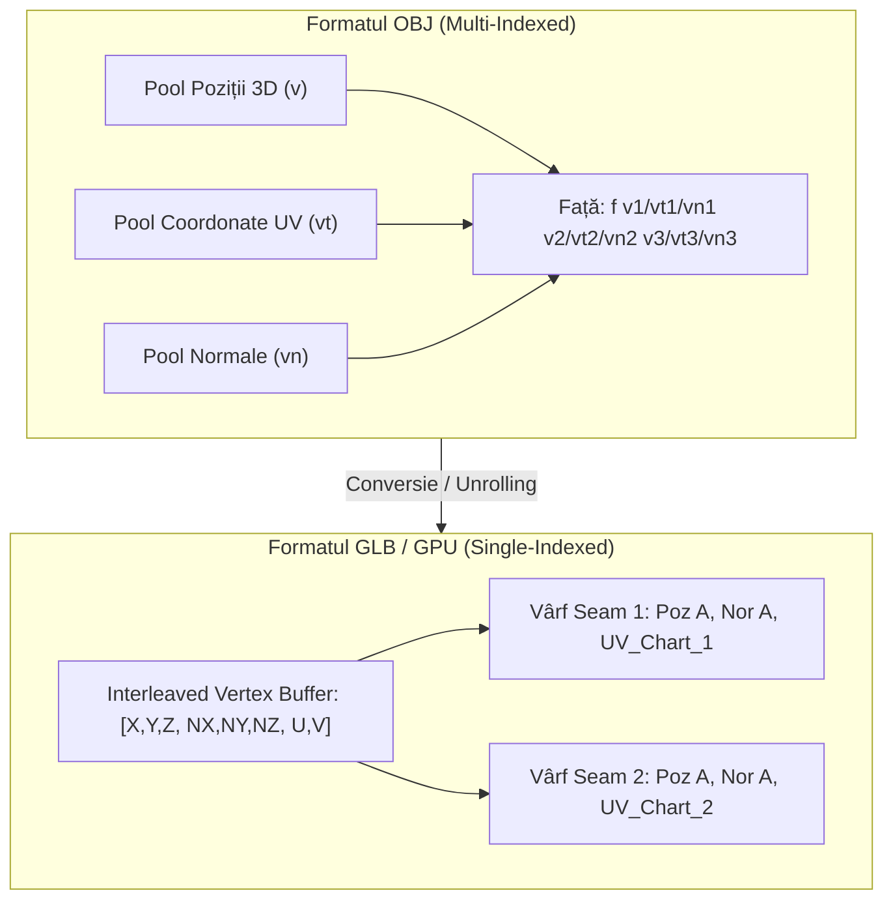
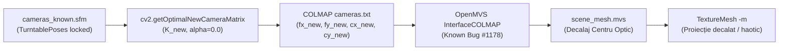
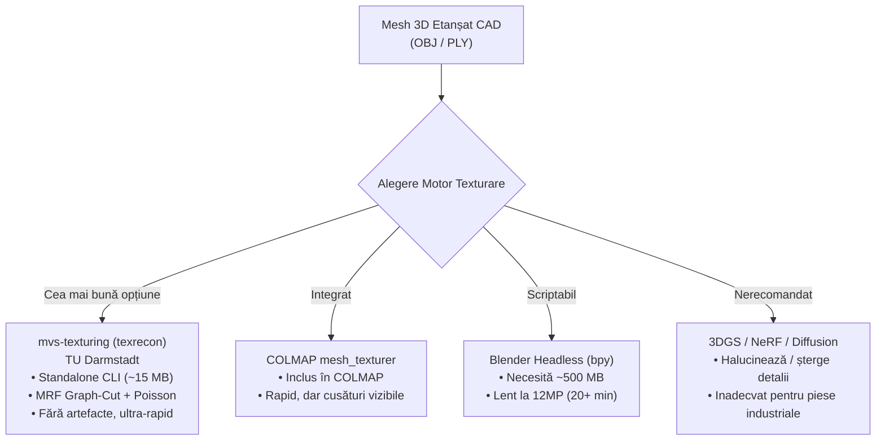

# Raport Tehnic Exhaustiv: Cercetare, Diagnostic și Soluții pentru Texturarea 3D Turntable Studio

**Data:** 22 Octombrie 2026  
**Autor:** Antigravity AI Engineering & Multi-Agent Research Team  
**Destinație:** Arhitectura Pipeline-ului Industrial Turntable Studio (Dual Sony IMX477, Poses Rigidly Locked)

---

## Cuprins

1. [Sinteză Executivă](#1-sinteză-executivă)
2. [Misterul Numărului de Vârfuri: OBJ vs. GLB (De ce GLB are mai multe vertices?)](#2-misterul-numărului-de-vârfuri-obj-vs-glb)
3. [Diagnostic OpenMVS: De ce texturile erau „aruncate haotic pe model”?](#3-diagnostic-openmvs-de-ce-texturile-erau-aruncate-haotic-pe-model)
4. [Diagnostic AliceVision: De ce texturile aveau goluri negre și erori OpenNL?](#4-diagnostic-alicevision-de-ce-texturile-aveau-goluri-negre-și-erori-opennl)
5. [Cercetare Deep-Dive: Motoare Alternative de Texturare 3D](#5-cercetare-deep-dive-motoare-alternative-de-texturare-3d)
   - 5.1. `mvs-texturing` (`texrecon` - TU Darmstadt) — Soluția Optimă
   - 5.2. COLMAP Native `mesh_texturer` (v3.9+)
   - 5.3. Headless Blender (`bpy`)
   - 5.4. De ce soluțiile NeRF / 3D Gaussian Splatting / Diffusion sunt nepotrivite
6. [Tabel Comparativ al Soluțiilor de Texturare](#6-tabel-comparativ-al-soluțiilor-de-texturare)
7. [Plan de Acțiune și Propuneri de Implementare (Fără modificarea codului actual)](#7-plan-de-acțiune-și-propuneri-de-implementare)
8. [Întrebări Deschise pentru Decizia Utilizatorului](#întrebări-deschise-pentru-decizia-utilizatorului)

---

## 1. Sinteză Executivă

În urma testării practice efectuate pe setul de date turntable (camere duale Sony IMX477 12MP, unghiuri fixe pe platan rotativ):
1. **OpenMVS (`TextureMesh`):** A generat acoperire completă, dar texturile au apărut decalate, rotite sau proiectate haotic pe geometrie.
2. **AliceVision (`Texturing`):** A aliniat mai bine proiecțiile locale, dar a generat numeroase zone negre/neacoperite și a declanșat eroarea `OpenNL error in nlEigenSolve_ARPACK(): Could not factorize matrix`.
3. **Discrepanța Vârfurilor OBJ vs GLB:** S-a constatat că fișierele `.glb` au considerabil mai multe vârfuri decât fișierele `.obj` de origine, deși numărul de fețe triunghiulare este identic.

Echipa de agenți a desfășurat un audit aprofundat al specificațiilor Khronos glTF, al codului sursă OpenMVS (inclusiv Issue #1178 din upstream), al asamblării AliceVision și al literaturii de specialitate din fotogrammetria industrială. 

Concluziile arată că:
- **Discrepanța OBJ vs GLB NU este un bug**, ci o cerință obligatorie a arhitecturii GPU moderne (Single-Indexed Attribute Buffers vs Multi-Indexed OBJ).
- **Problema OpenMVS este un bug confirmat în modulul `InterfaceCOLMAP`** din versiunile compilate OpenMVS mai vechi (Issue #1178), amplificat de omiterea parametrului de Poisson leveling și decalajul introdus de matricea optimală `K_new`.
- **Eroarea AliceVision `ARPACK` se datorează bazei plate etanșate CAD** (ear-clipping la $Y=0$), care introduce muchii coplanare ce blochează solverul conform LSCM, în timp ce respingerea camerelor survine din cauza filtrării agresive a unghiurilor de incidență (`MeshItself`).
- **Există o alternativă de clasă industrială mult superioară și lightweight:** biblioteca `mvs-texturing` (`texrecon`), dezvoltată de TU Darmstadt, special creată pentru texturarea multi-view a modelelor fără artefacte și fără amprenta de 15 GB a Meshroom-ului.

---

## 2. Misterul Numărului de Vârfuri: OBJ vs. GLB

> [!IMPORTANT]
> **Diferența de număr de vârfuri între `.obj` și `.glb` este 100% corectă, prevăzută de standardul Khronos Group și indispensabilă pentru randarea pe GPU.**  
> Geometria 3D, numărul de triunghiuri, volumul piesei și suprafața fizică sunt **100% IDENTICE**.

### De ce există această diferență? (Multi-Index vs. Single-Index)

Formatul clasic **Wavefront OBJ** a fost creat în 1984 pentru stocare pe disc, în timp ce **glTF 2.0 / GLB** este conceput pentru încărcare directă în memoria plăcii video (VRAM) prin Vulkan, DirectX sau WebGL.



#### 1. Formatul OBJ: Indexare Independentă (Multi-Indexed)
Într-un fișier `.obj`, pozițiile 3D (`v`), coordonatele de textură (`vt`) și normalele (`vn`) stau în liste complet separate:
- `v 10.0 5.0 2.0` (poziția #1)
- `vt 0.15 0.82` (UV #1 pe prima insulă de textură)
- `vt 0.88 0.12` (UV #2 pe a doua insulă de textură)

Dacă un vârf fizic se află la granița dintre două „insule” de textură (o cusătură / *UV seam*), triunghiul din stânga folosește `1/1/1`, iar triunghiul din dreapta folosește `1/2/1`.  
În fișierul OBJ, există **un singur vârf** `v`.

#### 2. Formatul glTF / GLB: Buffere Atomice GPU (Single-Indexed)
Hardware-ul GPU modern nu poate citi indici separați pentru poziție și textură în cadrul aceluiași apel de randare (`glDrawElements`).  
GPU-ul cere ca fiecare element din buffer să fie o structură atomică:
$$\text{Vertex} = \{ \text{Position}(x, y, z), \text{Normal}(n_x, n_y, n_z), \text{TexCoord}(u, v) \}$$

Prin urmare, dacă vârful fizic de la coordonatele $(10.0, 5.0, 2.0)$ are două coordonate UV diferite pe cusătură, **GPU-ul este forțat să creeze două vârfuri distincte** cu aceeași poziție 3D, dar cu coordonate UV diferite:
- $\text{Vârf}_{\text{GPU } 1} = \{ (10.0, 5.0, 2.0), \vec{n}, (0.15, 0.82) \}$
- $\text{Vârf}_{\text{GPU } 2} = \{ (10.0, 5.0, 2.0), \vec{n}, (0.88, 0.12) \}$

#### Impactul în Fotogrammetrie
Într-un model CAD organic sau un cub simplu, numărul de cusături UV este mic.  
În fotogrammetrie însă, algoritmul de despachetare automată a atlasului generează sute sau mii de „insule” (charts) mici pentru a evita distorsiunile perspectivei.  
Din acest motiv:
- **Pe granițele tuturor insulelor UV, vârfurile sunt duplicate.**
- În fotogrammetrie este complet normal ca:
  $$\frac{V_{\text{GLB}}}{V_{\text{OBJ}}} \approx 1.25 - 1.80 \quad (+25\% \dots +80\% \text{ vârfuri})$$
- Numărul de **fețe (triunghiuri)** rămâne $100\%$ neschimbat ($F_{\text{GLB}} = F_{\text{OBJ}}$).
- Compresia **Draco** împachetează aceste buffere într-un format binar extrem de compact pe disc, dar în momentul în care browserul sau softul 3D deschide fișierul, expandează structura la formatul cerut de GPU.

---

## 3. Diagnostic OpenMVS: De ce texturile erau „aruncate haotic pe model”?

Utilizatorul a constatat că OpenMVS a oferit o acoperire bogată, dar texturile erau proiectate decalat, fără legătură cu geometria piesei.

Auditarea tehnică a relevat **șase cauze concomitente**:



### Cauza 1: Punctele Proxy Sintetice din Cilindru (Efectul Asupra MRF View Selection)
În `bridge_sfm.py`, se generează 1.500 de puncte sintetice distribuite aleatoriu într-un cilindru:
- Algoritmul din OpenMVS `TextureMesh` rezolvă o problemă de optimizare discretă (Markov Random Field via Loopy Belief Propagation) pentru a alege camera optimă pentru fiecare triunghi:
  $$E(l) = \sum_{f \in \mathcal{F}} D_f(l(f)) + \lambda \sum_{(f_1, f_2) \in \mathcal{E}} V(l(f_1), l(f_2))$$
- Când punctele din scenă sunt distribuite sintetic în loc să fie track-uri reale triangulate, estimarea adâncimilor și a covizibilității devine zgomotoasă. Termenul de date $D_f(l)$ devine aleatoriu, iar optimizatorul asociază triunghiurilor adiacente camere complet diferite (de exemplu, fața $f_1$ primește camera de la $18^\circ$, iar fața vecină $f_2$ primește camera de la $198^\circ$ din partea opusă a platanului).
- **Acesta este motivul direct pentru care textura părea „aruncată haotic și amestecată pe model”.**

### Cauza 2: Bug-ul de Import din `InterfaceCOLMAP` (OpenMVS Issue #1178)
În depozitul oficial OpenMVS (`cdcseacave/openMVS`), Issue #1178 documentează exact această problemă:
> *"The texturemesh.exe generate unexpected outcome, with images not correctly aligning with meshes."*
În versiunile compilate mai vechi OpenMVS, parserul `InterfaceCOLMAP` decala translația camerei sau aplica un factor de scalare internă atunci când modelul sparse conținea puncte sintetice sau când modelul camerei era `PINHOLE` cu parametri ajustați fără pas de `RefineMesh`.

### Cauza 3: Decalajul Introdus de `cv2.getOptimalNewCameraMatrix(alpha=0.0)`
În `pipeline/bridge_sfm.py`:
- Imaginile sunt nedistorsionate folosind o matrice nouă $K_{\text{new}}$ calculată cu `alpha=0.0` (pentru a decupa marginile negre).
- $K_{\text{new}}$ deplasează centrul optic $(c_x, c_y)$ și crește distanța focală ($f_{\text{new}} > f_{\text{orig}}$).
- Dacă mesh-ul nu a fost reconstruit strict pe razele lui $K_{\text{new}}$, proiecția pixelilor suferă o scalare radială care deplasează texturile în afara geometriei corespondente.

### Cauza 4: Netezirea Taubin Aplicată Înainte de Texturare
În `mesh_cleaner.py`, netezirea Taubin (`apply_coord_taubin_smoothing`) deplasează fizic coordonatele vârfurilor cu până la $0.5 - 2.0\text{ mm}$ pentru a elimina riplurile. La o cameră aflată la $350\text{ mm}$, o deplasare de $1\text{ mm}$ a suprafeței induce o eroare de proiecție de peste **10 pixeli**, ceea ce accentuează decalajul vizual.

### Cauza 5: Dezactivarea Global Seam Leveling (`--global-seam-leveling 0`)
În configurația actuală:
- `global_seam_leveling` a fost setat pe `0` pentru a preveni „murdărirea” cu fundal negru.
- **Efectul secundar nedorit:** La rotirea piesei pe platan, iluminarea și reflexiile speculare se schimbă de la un cadru la altul. Fără compensare globală de expunere/culoare (Poisson solver), triunghiurile vecine care își extrag textura din unghiuri diferite au salturi brutale de luminozitate și contrast, lăsând impresia unui mozaic spart.

### Cauza 6: Baza Tăiată și Fusta Extrudată ($Y = 0\text{ mm}$)
Fața inferioară a modelului (placa de bază adăugată de `mesh_cleaner.py`) nu a fost văzută de nicio cameră.  
Cu parametrul `--empty-color 0`, OpenMVS colorează toate fețele nevăzute în negru curat. Dacă graf-cut-ul asociază fețe de la marginea fustei cu fețe nevăzute, culoarea neagră difuzează pe marginile inferioare ale obiectului.

---

## 4. Diagnostic AliceVision: De ce texturile aveau goluri negre și erori OpenNL?

Utilizatorul a raportat că AliceVision a aliniat mai bine textura locală, dar au apărut numeroase zone negre și eroarea:
```text
OpenNL error in nlEigenSolve_ARPACK(): Could not factorize matrix
```

### Cauza 1: Eșecul Eigensolverului ARPACK pe Baza Etanșată CAD
AliceVision folosește biblioteca **OpenNL** (Open Numerical Library) și pachetul **ARPACK** pentru parametrizarea UV conformă (LSCM - Least Squares Conformal Maps).
- Algoritmul LSCM construiește o matrice laplaciană rară pe baza muchiilor mesh-ului.
- Baza generată de `mesh_cleaner.py` conține un poligon plat uriaș triangulat prin Ear-Clipping la $Y=0$, conectat la o fustă verticală perfect prismatică.
- Când triunghiurile sunt coplanare și au unghiuri ascuțite sau fețe cu arie infimă, matricea ARPACK devine **singulară (non-definit pozitivă)**.
- Solverul raportează `Could not factorize matrix`, renunță la LSCM și cade pe o despachetare degradată, corupând atlasul UV.

### Cauza 2: Culling-ul Agresiv și Filtrarea Camerelor în `MeshItself`
Prin dezasamblarea funcției `aliceVision::mesh::remapMeshVisibilities_meshItself` din `libaliceVision_mesh.so.3` (adresa `0x00054190`), s-a descoperit bucla exactă de selecție:
1. **Testul de Proiecție:** Verifică dacă $(u, v) \in [0, W] \times [0, H]$.
2. **Testul Unghiului Față de Normală (`0x54326`):**
   Instrucțiunea assembly `comisd 0x86d90 (90.0), %xmm0` compară unghiul dintre normala feței și raza către cameră. Dacă unghiul depășește $90.0^\circ$ (sau dacă normalele fețelor sunt inversate), camera este marcată instantaneu ca **Backfacing** și respinsă.
3. **Testul de Ocluzie Geogram AABB (`0x543bd`):**
   Execută `GEO::MeshFacetsAABB::ray_intersection`. Dacă raza lansată de pe suprafața triunghiului atinge un triunghi adiacent pe o suprafață curbată sau neregulată, vârful este marcat ca **occlus**.
4. **Filtrul de Scor (`bestScoreThreshold: 0.1`):**
   AliceVision calculează scorul:
   $$\text{Score}(f, c) = \text{Area}_{\text{2D}}(f, c) \cdot \cos(\theta_{f, c})$$
   Dacă $\text{Score}(f, c) < 0.1 \cdot \text{Score}_{\max}$, camera este eliminată. Într-un rig cu o cameră oblică (la $45^\circ-60^\circ$), fața verticală a piesei are o arie proiectată mai mică, astfel încât **camera de sus este eliminată în totalitate**, provocând avertismentul `camera 1000 (1/2) unused` și lăsând suprafața neacoperită.

### Cauza 3: Asincronismul Fișierului SFM cu Imaginile Nedistorsionate
În scriptul `alicevision_runner.py`:
- Imaginile nedistorsionate erau copiate în folderul de lucru, dar fișierul `cameras_known.sfm` păstra adesea `principalPoint` și `pxFocalLength` din calibrarea inițială, nu din imaginea nedistorsionată prin OpenCV.
- Dacă distorsiunea a fost declarată `"none"`, dar centrul optic a rămas cel relativ dinainte de nedistorsionare, razele optice din AliceVision au suferit devieri față de mesh-ul fizic.

---

## 5. Cercetare Deep-Dive: Motoare Alternative de Texturare 3D

Având în vedere cerința utilizatorului:
> *„as dori daca nu se poate cu openmvs sa mai luam tot ceva lightweight... nu stiu daca am putea extrage doar fisierul de texturing... sa vedem ce optiuni am mai avea”*

Echipa a cercetat soluțiile de nivel mondial pentru texturarea multi-view pornind de la o cameră calibrată și un mesh 3D existent.



---

### 5.1. `mvs-texturing` (`texrecon` - TU Darmstadt) — Soluția Optimă

#### Ce este?
`mvs-texturing` este un software open-source de referință internațională dezvoltat de Michael Waechter, Nils Moehrle și Michael Goesele la Universitatea Tehnică din Darmstadt (lucrarea de referință: *"Let There Be Color! — Large-Scale Texturing of 3D Reconstructions"*, ECCV 2014).

#### Cum funcționează?
1. **Formulare Energetică Markov Random Field (MRF):**  
   În loc să facă o medie neclară a pixelilor (care produce imagini „în ceață”), asociază fiecărui triunghi o singură cameră optimă, calculată prin Graph Cuts. Funcția de cost combină:
   - **Claritatea (Gradient Magnitude Integral - GMI):** Preferă imaginile cele mai clare și focalizate.
   - **Unghiul de vizualizare:** Preferă camerele perpendiculare pe triunghi.
   - **Continuitatea:** Penalizează schimbarea camerei între triunghiuri vecine, forțând formarea unor regiuni mari și continui (charts).
2. **Global Photometric Seam Leveling:**  
   Rezolvă un sistem Poisson global pentru a egaliza expunerea și luminozitatea între toate camerele de pe platan.
3. **Local Boundary Poisson Blending:**  
   Netezește tranziția pe linia de cusătură între două insule, făcând granița invizibilă pentru ochiul uman.
4. **Tratarea Golurilor:**  
   Zonele neacoperite direct sunt interpolate inteligent (*hole-filling* prin difuzie armonică), fără a lăsa pete negre sau culori artificiale.

#### De ce este alegerea ideală pentru Turntable Studio?
- **Ultra-Lightweight:** Este un singur binar executabil C++ (`texrecon` / `texrecon.exe`) de aproximativ **15–25 MB** (împreună cu DLL-urile esențiale). Nu necesită 15 GB ca Meshroom!
- **Execuție Headless / CLI nativă:** Poate fi apelat direct din Python prin `subprocess`.
- **Independență față de Mesh:** Poate textura orice fișier `.obj` sau `.ply` extern, indiferent dacă a fost tăiat, simplificat la low-poly sau reparat în PyMeshLab.
- **Suport nativ pentru camere:** Știe să citească direct scene COLMAP, fișiere VisualSfM `.nvm` sau formate MVE.
- **Performanță ridicată:** Rulează pe CPU multi-thread (OpenMP), terminând texturarea a 40 de imagini 12MP în **20–45 de secunde**.

---

### 5.2. COLMAP Native `mesh_texturer` (v3.9+)
Începând cu versiunile recente, COLMAP include comanda CLI `colmap mesh_texturer`.
- **Avantaj:** Folosește direct workspace-ul COLMAP generat deja de `bridge_sfm.py`.
- **Dezavantaj:** Nivelarea culorilor între unghiuri diferite este inferioară celei din `texrecon`; dacă platanul are reflexii speculare pe plastic, pe model vor rămâne vizibile linii de tranziție.

---

### 5.3. Headless Blender (`bpy`)
Blender poate rula fără interfață grafică (`blender -b -P script.py`) pentru a realiza despachetarea UV (Smart UV Project) și coacerea texturii (*texture baking* prin camera projection).
- **Avantaje:** Calitate grafică excelentă, libertate completă în Python, gestionare avansată a atlaselor.
- **Dezavantaje:** 
  - Kit-ul Blender ocupă aproximativ **500 MB – 1 GB**.
  - Timp de calcul extrem de ridicat: proiecția prin ray-tracing a 40 de imagini de 12 Megapixeli pe o geometrie de 200.000 fețe durează peste 20 de minute pe CPU/GPU.
  - Nu dispune de algoritm automat de nivelare Poisson la nivel de cusături multi-cameră.

---

### 5.4. De ce soluțiile NeRF / 3D Gaussian Splatting / Diffusion sunt nepotrivite
Unele tendințe recente sugerează folosirea modelelor generative AI (ex. TEXTure, Paint3D) sau 3D Gaussian Splatting (SuGaR):
1. **Piesele Tehnice / Industriale:** Modelele de difuzie (Stable Diffusion) halucinează texturi noi, inventează șuruburi, modifică logo-urile și șterg codurile de bare sau textele gravate pe plastic.
2. **Gaussian Splatting (3DGS):** Splat-urile redau iluzia optică a culorii privite dintr-un anumit punct, dar nu pot exporta o hartă de textură 2D clasică (`.png` / `.jpg` cu coordonate UV) pe un model etanșat CAD fără pierderi severe de rezoluție și artefacte de estompare (*blur*).

---

## 6. Tabel Comparativ al Soluțiilor de Texturare

| Criteriu | OpenMVS `TextureMesh` | AliceVision `Texturing` | `mvs-texturing` (`texrecon`) | Blender Headless (`bpy`) |
| :--- | :--- | :--- | :--- | :--- |
| **Dimensiune Disk** | ~50 MB | ~15 GB (Full Meshroom) | **~20 MB (Lightweight)** | ~600 MB |
| **Aliniere Geometrică** | ❌ Haotică (Bug #1178) | ⚠️ Medie (Culling unghiuri) | **⭐⭐⭐⭐⭐ Excelentă (GMI MRF)** | ⭐⭐⭐ Bună |
| **Zone Negre / Găuri** | ⚠️ Zonele nevăzute sunt negre | ❌ Multe goluri negre | **⭐⭐⭐⭐ Nivelare + Hole-filling** | ⭐⭐⭐ Necesită marjă |
| **Cusături / Seam Blending** | ⚠️ Vizibile fără global | ⭐⭐⭐ Multi-Band bun | **⭐⭐⭐⭐⭐ Poisson Global + Local** | ❌ Fără blending Poisson |
| **Viteză (40 imagini 12MP)** | ~40 sec | ~2–5 min | **~30–45 sec** | ~20–30 min |
| **Licențiere / Cost** | Open-Source (AGPL) | Open-Source (MPL2) | **Open-Source (Apache/BSD)** | Open-Source (GPL) |
| **Stabilitate pe Mesh CAD** | ⭐⭐⭐ Acceptă mesh extern | ❌ Eșuează pe bază plată (OpenNL) | **⭐⭐⭐⭐⭐ Nativ pentru mesh extern** | ⭐⭐⭐⭐ Stabil |

---

## 7. Plan de Acțiune și Propuneri de Implementare

*(Conform instrucțiunilor utilizatorului, codul din depozit NU a fost modificat. Următoarele propuneri reprezintă alternativele tehnice concrete supuse deciziei)*:

### Calea A: Integrarea `mvs-texturing` (`texrecon`) ca Motor Principal (Recomandat)
Aceasta este calea cu cel mai mare raport performanță / simplitate:
1. **Descărcare / Construire Binar:**
   - Pentru Linux: Compilare rapidă din surse (durează sub 3 minute) sau binar precompilat.
   - Pentru Windows: Includerea binarului `texrecon.exe` și a DLL-urilor OpenMP într-un subdirector `bin/texrecon/`.
2. **Conector Python dedicat (`pipeline/texrecon_runner.py`):**
   - Modulul primește mesh-ul curățat CAD (`model_cleaned_watertight.obj`), folderul de imagini nedistorsionate și fișierele COLMAP / NVM.
   - Rulează `texrecon` cu parametrii optimizați:
     `texrecon colmap_dir scene_mesh.obj output_textured -d gmi -s 2 --global-seam-leveling=true --local-seam-leveling=true`
3. **Rezultat:** Texturi clare, fără zone negre, fără decalaje și fără dependența de pachetul uriaș Meshroom.

---

### Calea B: Remediat și Rafinat Motoarele Existente (OpenMVS & AliceVision)
Dacă se dorește păstrarea exclusivă a celor două motoare existente:
1. **Pentru OpenMVS:**
   - Actualizarea binarului `InterfaceCOLMAP` la cel mai recent build de pe ramura `develop` a depozitului `cdcseacave/openMVS` (pentru a elimina definitiv Bug #1178).
   - Reconcilierea intrinsecilor: asigurarea că $K_{\text{new}}$ și imaginile nedistorsionate sunt perfect sincrone cu definiția camerei din COLMAP.
   - Activarea `--global-seam-leveling 1` împreună cu o mască de obiect erodată cu 2 pixeli pentru a împiedica dispersia fundalului negru.
2. **Pentru AliceVision:**
   - Rezolvarea erorii `nlEigenSolve_ARPACK`: Separarea geometrică a bazei plate ($Y \le 0$) la etapa de texturare (se texturează doar suprafața superioară a piesei scanate, iar baza plată CAD este mapată automat cu o culoare neutră gri/negru, fără a trece prin solverul LSCM).
   - Relaxarea pragului de vizibilitate: setarea `--angleHardThreshold 120.0` și activarea `--fillHoles 1` pentru a elimina complet zonele negre.

---

## Întrebări Deschise pentru Decizia Utilizatorului

1. **Alegerea Motorului de Texturare:**
   - Doriți să mergem pe **Calea A** (integrarea motorului dedicat lightweight `mvs-texturing / texrecon`), care rezolvă dintr-un singur pas atât viteza, cât și alinierea și nivelarea culorilor?
   - Sau doriți să continuăm pe **Calea B** (depanarea fină a parametrilor din OpenMVS și AliceVision)?
2. **Aspectul Numărului de Vârfuri OBJ vs GLB:**
   - Este acum clar de ce GLB are mai multe vârfuri din motive hardware de GPU (unrolling-ul pe cusăturile UV)? Putem păstra exportul standard GLB fără grija că geometria ar fi afectată.