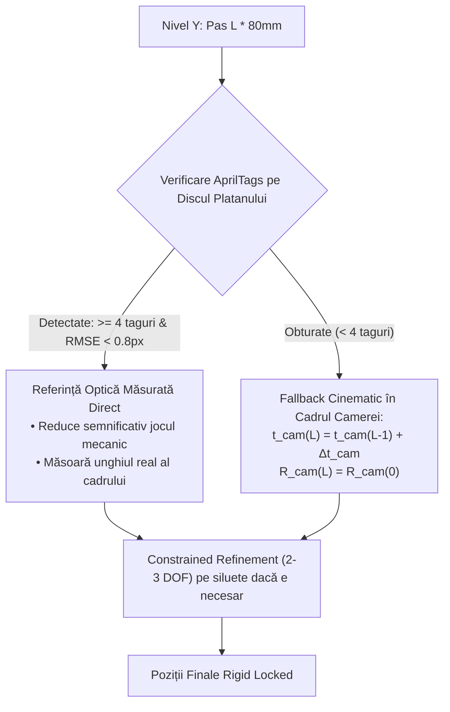
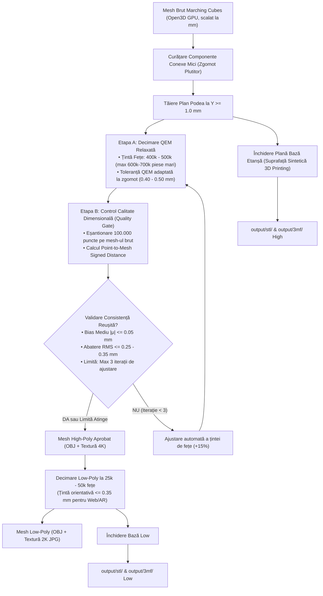
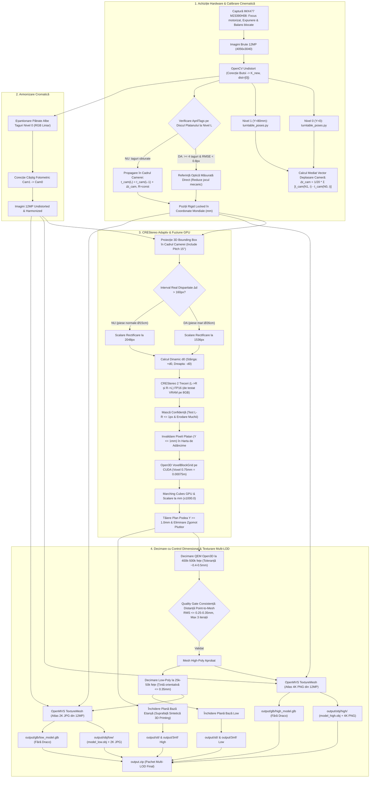

# Plan Tehnic de Arhitectură: CREStereo, Fuziune TSDF și Texturare Rapidă 4K/2K

**Proiect:** Turntable Studio — Pipeline 3D Industrial  
**Data:** 24 Octombrie 2026 (Revizia 7 — Calibrare Optică M23390H08, Proiecție 3D BBox, Criterii Metrologice Realiste și Limite de Texturare)  
**Status:** În Validare / Arhitectură Agreată  
**Hardware Țintă:** GPU local 8 GB VRAM (RTX seria 20/30/40) & server RTX 4090 (24 GB) / 5090 (32 GB)  

---

## 1. Specificațiile Rig-ului Fizic, Procedura de Achiziție & Convenția de Coordonate

### 1.1. Specificațiile Hardware Reale ale Sistemului
* **Senzor Imagine (Sony IMX477):**
  * Rezoluție senzor: **$4056 \times 3040\text{ pixeli}$ (12.3MP)**.
  * Tip obturator: *Rolling shutter*.
  * Format optic: Type $1/2.3''$ ($6.287 \times 4.712\text{ mm}$).
  * Dimensiune pixel: **$1.55\,\mu\text{m} \times 1.55\,\mu\text{m}$**.
* **Ansamblu Optic (Lentilă Arducam M23390H08 M12 cu Focus Motorizat):**
  * Format optic: $1/2.3''$.
  * Distanță focală nominală: **$f = 3.9\text{ mm}$**.
  * Diafragmă: **F2.8**.
  * Câmp vizual orizontal (HFOV): **$75.0^\circ$**.
  * Back Focal Length (BFL): **$4.49\text{ mm}$**.
  * Distanță minimă de focalizare (MOD): **$0.3\text{ m} = 300\text{ mm}$** (perfect aliniată cu distanța de lucru a rig-ului $D \approx 325\text{ mm}$).
  * Dimensiuni & Greutate: $\varnothing 14 \times 18.67\text{ mm}$, $5\text{ g}$.
  * **Sistem de focalizare dublu:** reglaj mecanic de bază pe filet M12 + **motoraș pas-cu-pas intern pentru focus electronic**.
* **Distanța Focală în Pixeli:**
  * **Rezoluție Nativă (12MP, $4056 \times 3040$):**
    $$f_{\text{nat}} = \frac{3.9\text{ mm}}{0.00155\text{ mm}} \approx \mathbf{2516\text{ px}}$$
  * **Rezoluție 2K ($2048 \times 1536$):**
    $$f_{2K} = 2516 \times \frac{2048}{4056} \approx \mathbf{1271\text{ px}}$$
  * **Rezoluție 1536 ($1536 \times 1152$):**
    $$f_{1536} = 2516 \times \frac{1536}{4056} \approx \mathbf{953\text{ px}}$$
* **Geometrie Rig Dual-Cameră:**
  * Unghi orizontal între cele două camere pe cărucior: **$27.0^\circ$**.
  * Înclinație verticală (*pitch*): **$15.0^\circ$ în jos** spre centrul platanului.
  * Distanță de lucru: **$D \approx 300\text{--}350\text{ mm}$** (nominal $325\text{ mm}$) față de axa de rotație a platanului.
* **Mecanică & Elevator Vertical:**
  * Platan rotativ de $\varnothing 260\text{ mm}$ prevăzut pe perimetrul exterior cu o coroană circulară de markeri **AprilTag (Tag36h11)**.
  * Rotație platan: **20 de opriri de $18.0^\circ$** ($360^\circ$ total).
  * Șină de ghidaj verticală cu **tijă filetată T8** acționată de motor pas-cu-pas. Pas de ridicare între etaje: **$\Delta Y = 80.0\text{ mm}$ (8 cm)**. Cursă verticală utilă: până la **$40\text{ cm}$ (400 mm)** (maxim 5–6 etaje).
  * **Senzor optic de înălțime (ToF):** montat pe cărucior pentru detectarea prezenței corpului piesei.
* **Proprietatea Stereoscopică Intercalată ($9.0^\circ$):**
  $$\gcd(27^\circ, 18^\circ) = 27^\circ - 18^\circ = 9.0^\circ$$
  La fiecare nivel vertical, combinarea celor două camere la cele 20 de opriri produce **40 de unghiuri intercalate uniform la exact $9.0^\circ$** în jurul piesei (bază stereoscopică liniară $B = 2 D \sin(4.5^\circ) \approx \mathbf{51.0\text{ mm}}$ la $D = 325\text{ mm}$, raport $B/D \approx 0.157$, optim pentru corelația stereo).

### 1.2. Protocolul Automat de Inițializare și Scanare
1. **Coborâre la Cota Zero (Nivelul 0, $Y = 0$):**
   * Căruciorul coboară la originea cursei.
2. **Calibrare și Blocare Hardware Strictă:**
   * **Focus Motorizat:** Motorașul intern poziționează lentila pentru claritate optimă (adâncime de câmp centrată pe axa platanului), după care **focusul este blocat hardware** pe toată durata scanării (fără autofocus dinamic pe parcursul sesiunii).
   * **Expunere & ISO:** Timpul de expunere (*shutter speed*) și amplificarea (*gain/ISO*) sunt măsurate o singură dată și **blocate manual în hardware** prin `libcamera`/V4L2.
   * **Balans de Alb (AWB):** Coeficienții $WB_R, WB_B$ sunt blocați pe valori fixe.  
     *(Motiv critic: Perechea stereo de $9.0^\circ$ compară cadre de la Camera 0 și Camera 1 la momente diferite; orice ajustare dinamică de expunere/AWB distruge consistența fotometrică necesară corelației neurale).*
3. **Ciclul de Scanare la un Nivel:**
   * La fiecare din cele 20 de opriri ($18.0^\circ$), sistemul așteaptă **300–500 ms** pentru amortizarea vibrațiilor mecanice, apoi declanșează simultan ambele camere.
4. **Tranziția pe Verticală & Detecția Înălțimii:**
   * După finalizarea celor 20 de cadre (40 de fotografii) la nivelul curent, sistemul verifică prezența obiectului prin senzorul ToF (și validare pe masca optică).
   * Dacă obiectul este detectat, elevatorul urcă un pas de $\Delta Y = 80\text{ mm}$ și reia ciclul de 20 de opriri.
   * Dacă pe etajul curent senzorul ToF nu mai detectează obiectul, ciclul de urcare se oprește. Datorită înclinării camerelor de $15.0^\circ$ în jos, acest ultim etaj capturează vederi oblice superioare (**top-down views**) care acoperă racordările, teșiturile și muchiile superioare.  
     *(Notă de geometrie: Suprafețele plane complet orizontale de sus sunt văzute sub un unghi de incidență foarte mare, $\approx 75^\circ$, unde precizia stereoscopică este redusă; închiderea plană etanșă se aplică strict bazei inferioare la $Y = 1.0\text{ mm}$, fără a inventa fețe superioare).*

### 1.3. Convenția Unică a Axelor & Unități de Măsură
* **Sistemul de Coordonate Mondial (World / Turntable Frame, $O_{tt}$):**
  * **Planul platanului:** planul $(X, Z)$ la cota **$Y = 0.0\text{ mm}$**.
  * **Axa de rotație:** axa verticală **$+Y$ (Up)**.
  * **Unitatea de măsură în codul de proiectare, rapoarte și fișiere finale (OBJ, STL, 3MF):** **milimetrul (mm)**.
* **Atenție la API-ul Tensorial Open3D (`VoxelBlockGrid`):**
  * Lucrează nativ în **metri (m)** ($1\text{ mm} = 0.001\text{ m}$).
  * La extragerea mesh-ului prin Marching Cubes, coordonatele vârfurilor sunt scalate riguros cu factorul $\times \mathbf{1000.0}$ (`mesh.scale(1000.0)`) înainte de curățare, decimare și texturare în OpenMVS.

---

## 2. Solver Cinematic în Cadrul Camerelor (Camera-Centric Kinematics)

### 2.1. De ce Definirea Direcției Șinei în Cadrul Platanului este Eronată Fizic
În specificația inițială s-a presupus formula $\mathbf{t}_L = \mathbf{t}_{L-1} - R \cdot (\Delta Y \cdot \vec{u}_{\text{rail}})$, considerând $\vec{u}_{\text{rail}}$ un vector fix în cadrul platanului. Aceasta este o eroare fizică:
* **Șina mecanică este fixă în laborator.** Dacă șina prezintă o înclinare mecanică minoră de $\epsilon = 0.3^\circ$, componenta ei orizontală este fixă în laborator.
* **Platanul se rotește în laborator cu unghiul $\theta_i = i \cdot 18.0^\circ$.** Prin urmare, văzută din sistemul de axe al platanului, componenta orizontală a șinei fixe se rotește cu $-\theta_i$ la fiecare oprire!
* Presupunerea unui vector $\vec{u}_{\text{rail}}$ constant în sistemul platanului ar fi echivalentă cu a presupune că șina fizică se rotește în laborator odată cu platanul. Pe o cursă de 400 mm, o abatere de $0.3^\circ$ înseamnă $\Delta X \approx 400 \cdot \tan(0.3^\circ) \approx \mathbf{2.1\text{ mm}}$ (adică de **$\approx 2.8\times$** dimensiunea voxelului de $0.75\text{ mm}$), distrugând triangularea.

### 2.2. Soluția Cinematică Directă în Cadrul Camerelor (*Camera-Centric Formulation*)
Deoarece ambele camere sunt montate rigid pe căruciorul elevatorului, iar elevatorul culisează rigid pe șină:
1. **Invarianța Deplasării în Cadrul Camerei:**
   * La orice oprire a platanului $i$, orientarea camerei în raport cu laboratorul este constantă ($R_{\text{cam}\leftarrow\text{lab}} = \text{const}$).
   * Deplasarea mecanică a căruciorului în laborator $\vec{d}_{\text{rail}}^{\text{lab}} = \Delta Y \cdot \hat{u}_{\text{rail}}^{\text{lab}}$ proiectată în sistemul de coordonate al camerei este:
     $$\Delta \mathbf{t}_{\text{cam}} = R_{\text{cam}\leftarrow\text{lab}} \cdot \vec{d}_{\text{rail}}^{\text{lab}} = \mathbf{const}$$
   * Vectorul de translație $\Delta \mathbf{t}_{\text{cam}}$ este **strict identic și constant pentru toate cele 20 de unghiuri $i$**!
2. **Estimarea Mediată Robustă (Nivel 0 $\to$ Nivel 1):**
   * La Nivelul 0 ($Y = 0$) și Nivelul 1 ($Y = 80\text{ mm}$), markerii AprilTag de pe platan sunt vizibili.
   * Pentru fiecare cameră, calculăm deplasarea la fiecare oprire $i$: $\Delta \mathbf{t}_i = \mathbf{t}_{\text{cam}}(\text{Nivel 1}, i) - \mathbf{t}_{\text{cam}}(\text{Nivel 0}, i)$.
   * Mediem pe cele 20 de opriri:
     $$\Delta \mathbf{t}_{\text{cam}} = \frac{1}{20} \sum_{i=0}^{19} \left[ \mathbf{t}_{\text{cam}}(\text{Nivel 1}, i) - \mathbf{t}_{\text{cam}}(\text{Nivel 0}, i) \right]$$
   * Medierea pe 20 de poziții reduce zgomotul de detecție optic al tagurilor cu un factor de $\sqrt{20} \approx \mathbf{4.47\times}$.
3. **Propagarea Directă la Nivelele Superioare ($Y \ge 160\text{ mm}$):**
   * Când piesa obturează AprilTags la nivelurile superioare, translația camerei se propagă direct, fără a trece prin matricea de rotație a platanului:
     $$\mathbf{t}_{\text{cam}}^{(L)} = \mathbf{t}_{\text{cam}}^{(L-1)} + \Delta \mathbf{t}_{\text{cam}} = \mathbf{t}_{\text{cam}}^{(0)} + L \cdot \Delta \mathbf{t}_{\text{cam}}$$
   * Orientarea camerei $R_i^{(L)} = R_i^{(0)}$ rămâne locked.

### 2.3. Calibrarea Prealabilă a Profilului Șinei (Panou Etalon Vertical)
Pentru obiecte înalte de până la 40 cm (400 mm), simpla extrapolare a pasului de 80 mm poate acumula erori dacă șina are o ușoară curbură sau variație de pas T8 pe lungime.
* **Procedură de calibrare dedicată (fără obiect):** Se plasează pe platan un turn/panou vertical rigid prevăzut cu AprilTags de la $Y = 0$ până la $Y = 400\text{ mm}$.
* Se execută o cursă completă a elevatorului ($L \in \{0, 1, 2, 3, 4, 5\}$).
* Se determină și se salvează în `rail_calibration.json` vectorii exacți $\Delta \mathbf{t}_{\text{cam}}(L)$ și eventualele micro-rotații parazite ale căruciorului $\Delta R_{\text{cam}}(L)$.

---

## 3. Disparitate prin Proiecția Volumului 3D, Undistortion și Măști de Confidență

### 3.1. Corecția Distorsiunii Optice (`Undistort`) & Matricea $K_{\text{new}}$
* **Deformarea corectivă prealabilă:** Lentilele M12 M23390H08 au o distorsiune optică radială de butoi. Înainte de rectificarea stereo și texturare, imaginile native de 12MP ($4056 \times 3040$) sunt transformate prin `cv2.undistort()` pe baza coeficienților $[k_1, k_2, p_1, p_2, k_3]$ calibrați.
* **Regulă critică de geometrie:** Imaginile rectificate devin proiecții strict liniare (rectilinii), având coeficienții de distorsiune zero: $[0, 0, 0, 0, 0]$. Ele sunt guvernate în continuare de **noua matrice a camerei $K_{\text{new}}$** (obținută prin `cv2.getOptimalNewCameraMatrix`). Toate fișierele de camere transmise către OpenMVS conțin $K_{\text{new}}$ și distorsiune zero.
* **Imaginile pentru Texturarea 4K:** Textura finală se extrage exclusiv din imaginile **undistorted la rezoluție nativă 12MP ($4056 \times 3040$)**, și NICIODATĂ din imaginile reduse la 2K folosite la stereo matching.

### 3.2. Proiecția Volumului Delimitator 3D vs. Estimarea Simplificată $D \pm R$

> [!WARNING]
> **De ce $Z = D \pm R$ este o estimare prea optimistă:**
> Formula simplistă $Z = D \pm R$ consideră doar secțiunea orizontală centrală a piesei.
> Datorită **înclinării de $15.0^\circ$ în jos** a camerei, adâncimea pe axa optică a camerei $Z_{\text{cam}}$ variază puternic și în funcție de cota verticală $Y$ a punctelor vizibile în cadru:
> $$Z_{\text{cam}} = \cos(15^\circ) \cdot Z_{\text{world\_rel}} - \sin(15^\circ) \cdot Y_{\text{world\_rel}}$$
> Termenul $-\sin(15^\circ) \cdot Y$ induce o variație suplimentară de $\Delta Y \cdot \sin(15^\circ) \approx \pm 40\text{--}50\text{ mm}$ între baza și vârful câmpului vizual al unui cadru.

**Algoritmul Exact de Calcul al Disparității:**
1. Se definește cilindrul sau cutia de încadrare 3D (*3D Bounding Box*) a piesei în coordonate mondiale: $X \in [-R, R], \; Y \in [Y_{\text{bottom}}, Y_{\text{top}}], \; Z \in [-R, R]$.
2. Se proiectează cele 8 vârfuri ale BBox-ului în sistemul de coordonate rectificat al fiecărei perechi de camere:
   $$Z_{\min} = \min_{\mathbf{X} \in \text{BBox}} Z_{\text{cam}}(\mathbf{X}), \quad Z_{\max} = \max_{\mathbf{X} \in \text{BBox}} Z_{\text{cam}}(\mathbf{X})$$
3. Disparitățile extremale se calculează riguros:
   $$d_{\max} = \frac{f_{2K} \cdot B}{Z_{\min}}, \quad d_{\min} = \frac{f_{2K} \cdot B}{Z_{\max}}, \quad \Delta d = d_{\max} - d_{\min}$$

#### Tabelul Comparativ al Intervalelor Reale de Disparitate (2K, $f_{2K} = 1271\text{ px}$, $B = 51.0\text{ mm}$ la $D = 325\text{ mm}$):

| Dimensiune Piesă | Adâncime Optică Reală ($Z_{\min} \dots Z_{\max}$) | $d_{\max}$ (px) | $d_{\min}$ (px) | Interval Real $\Delta d$ | Observații CREStereo |
| :--- | :---: | :---: | :---: | :---: | :--- |
| **Piesă Mică $\varnothing 10\text{ cm} \times 12\text{ cm}$** | $240\text{--}410\text{ mm}$ | $\approx 270\text{ px}$ | $\approx 158\text{ px}$ | **$\approx 112\text{ px}$** | ⭐ Optim (complet în fereastra $\le 160\text{ px}$) |
| **Piesă Tipică $\varnothing 15\text{ cm} \times 17\text{ cm}$** | $215\text{--}440\text{ mm}$ | $\approx 301\text{ px}$ | $\approx 147\text{ px}$ | **$\approx 154\text{ px}$** | La limita superioară a ferestrei optime |
| **Piesă Mare $\varnothing 26\text{ cm} \times 30\text{ cm}$** | $165\text{--}500\text{ mm}$ | $\approx 393\text{ px}$ | $\approx 130\text{ px}$ | **$\approx 263\text{ px}$** | ❌ Depășește grav plaja 2K ($\Delta d \gg 160\text{ px}$) |

#### Regula Automată de Comutare a Rezoluției:
> [!IMPORTANT]
> **Regula de Rezoluție Dinamică:**
> Dacă din proiecția 3D a volumului delimitator rezultă că $\Delta d > \mathbf{160\text{ px}}$:
> 1. Pipeline-ul comută automat rezoluția de inferență stereo de la 2048 la **1536 px** ($f_{1536} \approx 953\text{ px}$).
> 2. La 1536 px, intervalul de căutare se scalează cu factorul $\frac{1536}{2048} = 0.75$: pentru piesa de 26 cm, $\Delta d_{1536} \approx 197\text{ px}$, iar la $D = 350\text{ mm}$ ajunge la $\approx 158\text{ px} \le 160\text{ px}$, reintrând în zona de convergență stabilă a modelului.
> 3. Textura finală 4K rămâne complet neafectată, fiind proiectată din imaginile native de 12MP.

### 3.3. Convenția Semnului la Shift-ul Dinamic $d_0$
CREStereo este antrenat exclusiv pe disparități pozitive ($d \ge 0$).
* Pentru disparitatea $d = x_L - x_R \ge 0$, stabilim $d_0 = d_{\min} - 10\text{ px}$.
* **Inferența Stânga $\to$ Dreapta ($L \to R$):** Imaginea dreaptă rectificată se deplasează pe orizontală cu **$+d_0$** ($x_R' = x_R - d_0$). Disparitatea măsurată este $d' = d - d_0 \in [0, \Delta d]$, iar disparitatea reală se recompune ca $d_{\text{total}} = d' + d_0$.
* **Inferența Dreapta $\to$ Stânga ($R \to L$) pentru Verificarea L-R:** Deoarece rolurile se inversează ($d_R = x_R - x_L$), predeplasarea de compensare trebuie aplicată strict cu **semnul opus ($-d_0$)** pe imaginea stângă. Aplicarea aceluiași semn ar induce o decorelare eronată de $2 d_0$.

### 3.4. Măști de Confidență & Filtrarea „Flying Pixels”
1. **Verificare de Consistență Stânga-Dreapta (Left-Right Check):**
   * Pixelii unde $|d_L(u, v) - d_R(u - d_L(u, v), v)| > 1.0\text{ px}$ sunt marcați ca `NaN`/invalizi (zone ocluzionate sau reflexii).
2. **Mască de Siluetă (Visual Hull):**
   * Mască binară ce elimină fundalul cabinei foto și reflexiile din platan.
3. **Filtru Gradient de Margine (Anti-Flying Pixels):**
   * Pixelii cu gradient de adâncime abrupt ($|\nabla Z| > 15\text{ mm/px}$) sunt erodați cu 2 pixeli pentru a împiedica introducerea de pânze plutitoare în volumul TSDF.

---

## 4. Fuziune Volumetrică, Tăierea Podelei și Ierarhia de Decimare

### 4.1. Fuziune Volumetrică GPU & Tăierea Podelei în Două Etape
Modulul `open3d.t.geometry.VoxelBlockGrid` (rulat pe CUDA) nu oferă o funcție nativă de tăiere a unui plan în timpul integrării razelor. Tăierea discului platanului se execută în 2 pași:
1. **Pasul 1 (Pre-filtrare în adâncimi):** Pixelii a căror rază 3D intersectează platanul la $Y \le 1.0\text{ mm}$ sunt invalidați direct în harta de adâncime înainte de apelul `integrate()`.
2. **Pasul 2 (Post-procesare geometrică):** Mesh-ul brut extras prin Marching Cubes (la voxel de $0.75\text{ mm} = 0.00075\text{ m}$) este scalat la milimetri ($\times 1000.0$) și tăiat curat la planul $Y \ge 1.0\text{ mm}$ prin `trimesh.intersections.slice_mesh_plane()`.

### 4.2. Ierarhia de Decimare: De ce $\le 0.20\text{ mm}$ QEM Blochează Simplificarea
* **Zgomotul real TSDF:** Suprafața brută extrasă din Marching Cubes are un zgomot de discretizare și corelație de $\sigma \approx \mathbf{0.4\text{--}0.7\text{ mm}}$.
* **Comportamentul QEM:** Dacă algoritmului i se impune un prag de eroare sub zgomot ($\le 0.20\text{ mm}$), el interpretează ondulațiile zgomotului drept detalii CAD esențiale și refuză să colapseze muchiile (*edge-collapse stalling*). Rezultatul: mesh-ul rămâne la peste $1\text{--}1.5\text{ milioane}$ de fețe.
* **Clarificare tehnică Open3D:** Parametrul `maximum_error` din `mesh.simplify_quadric_decimation()` este o valoare internă a energiei cvadrice Garland-Heckbert, **nu o distanță Hausdorff în milimetri**.

### 4.3. Protocolul de Decimare & Control Dimensional Post-Procesare
Pipeline-ul separă procesul în două etape distincte:

* **Pentru High-Poly (400k–500k fețe, max 600k–700k pentru piese mari de 40 cm):** Decimarea reduce zgomotul de suprafață, iar controlul de consistență confirmă că abaterea RMS față de mesh-ul brut nu depășește $0.25\text{--}0.35\text{ mm}$.  
  *(Atenție: Quality Gate-ul măsoară consistența simplificării față de mesh-ul brut, nu acuratețea absolută a piesei reale. Pentru a preveni buclele infinite pe piese mari zgomotoase, bucla de ajustare are o **limită strictă de maxim 3 iterații**).*
* **Pentru Low-Poly (25k–50k fețe):** La $25\text{k}\text{--}50\text{k}$ triunghiuri, lungimea muchiei crește la $3\text{--}6\text{ mm}$, iar aproximarea coardă-arc pe curburi produce abateri geometrice naturale de $0.30\text{--}0.45\text{ mm}$. Criteriul este o **țintă orientativă de optimizare**.
* **Origine STL/3MF:** Modelele STL etanșe pornesc după curățarea zgomotului plutitor. Baza inferioară tăiată la $Y = 1.0\text{ mm}$ este o **suprafață plană sintetică**, generată strict pentru fixarea pe patul imprimantei 3D (fundul real al piesei fiind ascuns vederii în timpul scanării).

---

## 5. Analiza Erorii Unghiulare a Platanului & Criterii Metrologice Realiste

### 5.1. Impactul Jocului Mecanic al Platanului asupra Scalei Adâncimii
Perechea stereo de $9.0^\circ$ se bazează pe rotirea platanului cu $18.0^\circ$ combinată cu decalajul camerelor de $27.0^\circ$:
* O eroare mecanică de oprire sau joc al reductorului de doar $\delta \theta = 0.1^\circ$ generează o deviație pe baseline-ul nominal $B \approx 51.0\text{ mm}$:
  $$\Delta B \approx D \cdot \cos(4.5^\circ) \cdot \delta \theta_{\text{rad}} \approx 325 \cdot 0.9969 \cdot \left(0.1 \cdot \frac{\pi}{180}\right) \approx \mathbf{0.57\text{ mm}} \implies \frac{\Delta B}{B} \approx \mathbf{1.11\%}$$
* Deoarece adâncimea este $Z = \frac{f \cdot B}{d}$, o eroare relativă de $1.11\%$ pe baseline produce direct o **eroare de scalare a adâncimii**:
  $$\Delta Z = Z \cdot \frac{\Delta B}{B} \approx 325\text{ mm} \times 0.0111 \approx \mathbf{3.6\text{ mm}}!$$
* **Soluția de Salvare:** La nivelurile unde AprilTags sunt vizibile, unghiul fiecărui cadru este determinat direct optic din taguri cu precizie sub-pixel (RMSE < 0.8 px), **reducând semnificativ jocul mecanic al reductorului**. La nivelurile superioare, precizia depinde de calitatea mecanică a reductorului și de absența jocului (*backlash*).

### 5.2. Criterii Numerice Realiste de Acceptare pe Sferă și Etalon Mare

> [!WARNING]
> **Limite fizice ale sferei de calibrare:**
> 1. O sferă mată complet albă sau uniformă oferă o corelație stereo neurală slabă din cauza lipsei texturii de înaltă frecvență. **Protocolul cere pulverizarea fină a sferei cu un model aleatoriu de puncte (speckle pattern)** pentru a crea gradienți de intensitate.
> 2. O toleranță RMS de $\le 0.08\text{ mm}$ este incompatibilă cu un voxel de $0.75\text{ mm}$ și un zgomot brut de $0.4\text{--}0.7\text{ mm}$. Zgomotul de suprafață va domina eroarea.
> 3. Scara sistemului se observă cel mai bine pe dimensiuni mari. Protocolul include atât o sferă de $\varnothing 50\text{ mm}$, cât și un **etalon cilindric mare de $\varnothing 100\text{--}150\text{ mm}$**, precum și testare pe **plastic negru tehnic real**.

#### Praguri Progresive de Acceptare:

| Parametru Metrologic | Metodă de Măsurare | Prag Faza 1 (Calibrare Inițială) | Prag Faza 2 (Optimizat de Producție) |
| :--- | :--- | :---: | :---: |
| **Eroare Dimensională Diametru** | $\|\varnothing_{\text{măsurat}} - \varnothing_{\text{nominal}}\|$ pe etalon $\varnothing 50\text{--}150\text{ mm}$ | $\le \mathbf{0.30\text{--}0.50\text{ mm}}$ | $\le \mathbf{0.15\text{--}0.20\text{ mm}}$ |
| **Eroare de Formă / Sfericitate (RMS)** | $\text{RMS} = \sqrt{\frac{1}{N} \sum (r_i - r_{\text{mediu}})^2}$ | $\le \mathbf{0.30\text{--}0.50\text{ mm}}$ | $\le \mathbf{0.20\text{ mm}}$ |
| **Abatere Maximă Vârf-la-Vârf ($P-V$)** | $r_{\max} - r_{\min}$ (percentila 99%) | $\le \mathbf{0.80\text{ mm}}$ | $\le \mathbf{0.40\text{ mm}}$ |
| **Stabilitate Traiectorie Centru** | Variația radială a centrului la rotația $360^\circ$ | $\le \mathbf{0.15\text{ mm}}$ | $\le \mathbf{0.08\text{ mm}}$ |

---

## 6. Bugetul de Timp și Memorie VRAM (Ținte de Validat pe Rig)

### 6.1. De ce Verificarea Left-Right Dublează Trecerile CREStereo
Fiecare pereche stereo necesită 2 inferențe complete de rețea neuronală:
1. Trecerea 1 ($L \to R$): calculează $d_L$.
2. Trecerea 2 ($R \to L$): inversează cadrele și calculează $d_R$ cu deplasare opusă ($-d_0$).
La 20 de perechi pe etaj, se execută **40 de inferențe CREStereo per nivel vertical**.

### 6.2. Tabel de Buget de Timp (Ținte Orientative de Proiectare)
Valorile de mai jos reprezintă **obiective de proiectare și ipoteze de calcul**, urmând a fi validate și profilate pe hardware-ul fizic (RTX 4090 de producție vs. GPU local de 8 GB):

| Etapă de Procesare | 1 Nivel (20 perechi / 40 vederi) | 3 Niveluri (60 perechi / 120 vederi) | 6 Niveluri (120 perechi / 240 vederi) | Statut & Observații |
| :--- | :--- | :--- | :--- | :--- |
| **1. Undistort & Resize 2K (OpenCV)** | ~4 s | ~12 s | ~24 s | Țintă, de validat |
| **2. Solver Poziții (Optic + Cinematic)** | ~2 s | ~3 s | ~5 s | Țintă, de validat |
| **3. CREStereo 2K FP16 + Mască L-R (2 treceri)** | **~40 s** | **~120 s** | **~240 s** | ~2.0 s / pereche cu L-R pe RTX 4090 |
| **4. Fuziune TSDF GPU (VoxelBlockGrid)** | ~2 s | ~5 s | ~10 s | Integrare tensorială CUDA |
| **5. Marching Cubes, Crop Podea & Curățare** | ~3 s | ~6 s | ~12 s | Extragere și tăiere $Y \ge 1\text{ mm}$ |
| **6. Decimare QEM Open3D + Quality Gate** | ~4 s | ~8 s | ~16 s | Simplificare la ~400k–500k fețe |
| **7. Texturare OpenMVS (Atlas 4K + 2K)** | ~25 s | ~45 s | ~85 s | Proiecție MRF din cadre native 12MP |
| **8. Export Multi-LOD (OBJ, GLB, STL, ZIP)**| ~5 s | ~8 s | ~12 s | Serializare I/O pachet final |
| **TIMP TOTAL ESTIMAT DE CALCUL** | **~1.4 min** | **~3.5 min** | **~6.7 min** | ⭐ **Țintă de performanță, de validat** |

* **Consum VRAM estimat:** la rezoluție 2K în FP16 mixed-precision (batch size 1), CREStereo este calibrat ipotetic la $\sim 4.5\text{--}6.0\text{ GB}$ VRAM. Pe plăcile locale de 8 GB (RTX 3070 / 4060) la $2048 \times 1536$, consumul exact și riscul de OOM trebuie testate empiric; la nevoie, comutarea pe 1536 px reduce consumul de memorie cu $\approx 40\%$.

---

## 7. Texturarea și Limita Impusă de Acuratețea Geometrică

> [!IMPORTANT]
> **Limita Fizică a Calității Texturii (Geometrie vs. Rezoluție Atlas):**
> * Un pixel de pe senzorul de 12MP acoperă pe suprafața piesei la $D \approx 325\text{ mm}$ o arie de $\approx \mathbf{0.13\text{ mm}}$.
> * Eroarea spațială a geometriei reconstruite (zgomot TSDF și toleranțe mecanice) este de ordinul **$0.3\text{--}0.7\text{ mm}$**.
> * O abatere geometrică de doar $0.5\text{ mm}$ a unui punct de pe suprafață induce o eroare de reproiecție de:
>   $$\Delta u \approx \frac{f_{\text{nat}}}{Z} \cdot \Delta X_{\perp} \approx \frac{2516\text{ px}}{325\text{ mm}} \cdot 0.5\text{ mm} \approx \mathbf{3.9\text{ pixeli}}$$
> * Când OpenMVS proiectează fotografii din unghiuri diferite pe aceeași fațetă sau fațete vecine, acest decalaj de ~4 pixeli produce **dedublări locale și estompări (ghosting / blur)**, în special la unghiuri oblice de vizualizare.
> * *Local Poisson Seam Leveling* din OpenMVS rezolvă discontinuitățile de luminanță și culoare la granițele insulelor UV, dar **nu poate corecta dedublarea structurală cauzată de erorile geometrice ale mesh-ului**.
> * **Concluzie de Proiectare:** Claritatea texturii este plafonată în primul rând de fidelitatea geometriei, nu de mărimea atlasului. Un atlas 4K ($16.7\text{ Mpx}$) este optim; generarea unui atlas 8K pe o geometrie cu zgomot de 0.5 mm nu ar aduce detalii reale noi, ci doar ar randa cu rezoluție mai mare un blur de reproiecție.

### 7.1. Armonizarea Culorii pe Pătratele Albe AprilTag
* Eșantionăm pătratele albe de pe plăcile AprilTag vizibile la **Nivelul 0 ($Y = 0$)**.
* Se lucrează în **RGB liniar** (după eliminarea curbei gamma sRGB), excluzând pixelii saturați ($RGB > 250$).
* Se calculează coeficienții fotometrici de corecție $g_R, g_G, g_B$ pentru a armoniza Camera 1 cu Camera 0.
* OpenMVS `TextureMesh` aplică *Local Poisson Seam Leveling* pe cadrele de 12MP pentru continuitate pe granițele insulelor UV.

### 7.2. Formatul GLB
* `high_model.glb` (cu PNG 4K) și `low_model.glb` (cu JPG 2K) sunt generate direct fără compresie Draco în rulajul curent de test, pentru compatibilitate maximă cu visualizerele 3D standard.

---

## 8. Matricea de Conformitate Legală și Licențiere

| Componentă / Bibliotecă | Licență Oficială | Tip Licență | Statut în Turntable Studio |
| :--- | :--- | :--- | :--- |
| **OpenMVS** | **AGPL-3.0** | Copyleft Puternic | ✅ **Conform.** Rulare locală / container. |
| **Open3D** | **MIT** | Permisivă / Comercial | ✅ **Conform.** Motor implicit pentru VoxelBlockGrid, Marching Cubes și decimare QEM. |
| **PyTorch** | **Modified BSD** | Permisivă / Comercial | ✅ **Conform.** Rulare inferență neurală tensorială. |
| **COLMAP** | **BSD-3-Clause** | Permisivă | ✅ **Conform.** Parsare și validare camere. |
| **CREStereo (Cod)** | **Apache-2.0** | Permisivă / Comercial | ✅ **Conform.** Cod oficial Megvii. |
| **CREStereo (Ponderi)** | **De verificat** | Ponderi pre-antrenate | ⚠️ **De verificat** licențele dataseturilor de antrenare (Sceneflow vs ETH3D research). |
| **OpenCV** | **Apache-2.0** | Permisivă | ✅ **Conform.** Undistortion, procesare imagini, rectificare. |
| **Trimesh** | **MIT** | Permisivă | ✅ **Conform.** Tăiere plan podea, manipulare mesh și generare GLB. |
| **PyMeshLab** | **GPL-3.0** | Copyleft | ℹ️ **Opțional / Fallback.** Decimarea implicită rulează pe Open3D (MIT). |
| **Nvidia `nvdiffrast`** | **NVIDIA Source Code License** | ⚠️ Restricționat (Non-Commercial) | ❌ **EXCLUS COMPLET DIN PIPELINE.** Nu se folosește în proiect. |

---

## 9. Arhitectura Completă a Pipeline-ului Industrial

---

## 10. Plan de Implementare Pas cu Pas & Protocol de Validare

### Etapa 0: Curățarea Arhitecturii (COMPLET EXECUTAT)
* Șters complet integrarea AliceVision din cod și teste.
* Setat `openmvs` ca motor implicit de texturare în `PipelineConfig` și CLI.
* Trecut `mesh_cleaner` pe `clean_mesh = False` implicit (păstrat fișierul pentru generarea bazelor STL/3MF).

### Etapa 1: Repararea Containerului Docker (Eroarea 127)
* Adăugarea bibliotecilor OpenCV de sistem (`libopencv-imgcodecs4.5d`, `libopencv-core4.5d`, `libopencv-calib3d4.5d`) în `Dockerfile` și configurarea `ldconfig` pentru ca `InterfaceCOLMAP` și `TextureMesh` să ruleze fără eroare de biblioteci partajate.

### Etapa 2: Modulul `pipeline/rig_kinematics.py`
* Implementarea solverului hibrid în cadrul camerelor:
  1. Calculul vectorului mediat de deplasare a camerelor:
     $$\Delta \mathbf{t}_{\text{cam}} = \frac{1}{20} \sum_{i=0}^{19} \left[ \mathbf{t}_{\text{cam}}(\text{Nivel 1}, i) - \mathbf{t}_{\text{cam}}(\text{Nivel 0}, i) \right]$$
  2. Verificarea detecției AprilTags la fiecare nivel: dacă $\ge 4$ taguri sunt vizibile cu RMSE < 0.8 px, se folosesc pozițiile optice directe; altfel, propagare cu $\mathbf{t}_L = \mathbf{t}_{L-1} + \Delta \mathbf{t}_{\text{cam}}$.
  3. Modul opțional de calibrare cu turn vertical cu AprilTags pe 400 mm (`rail_calibration.json`).

### Etapa 3: Modulul `pipeline/image_harmonizer.py`
* Corecție de distorsiune lentilă prin `cv2.undistort()`, exportul imaginilor rectificate cu noua matrice $K_{\text{new}}$ și vector de distorsiune zero.
* Eșantionarea pătratelor albe AprilTag de la Nivelul 0 în RGB liniar și calculul câștigului fotometric Cam1 $\to$ Cam0.

### Etapa 4: Modulul `pipeline/neural_stereo.py` & `pipeline/surface_integrator.py`
* Calculul dinamic al intervalului $\Delta d$ prin proiecția 3D BBox (inclusiv efectul pitch-ului de $15.0^\circ$): dacă $\Delta d > 160\text{ px}$, comutare automată pe rezoluție 1536 px; altfel, rulare la 2048 px.
* Inferență CREStereo în două treceri ($L \to R$ cu $+d_0$, $R \to L$ cu $-d_0$) cu verificare de consistență L-R ($\le 1.0\text{ px}$) și filtrare a muchiilor cu gradient mare.
* Fuziune tensorială GPU `open3d.t.geometry.VoxelBlockGrid` (voxel $0.75\text{ mm} = 0.00075\text{ m}$) cu invalidare preliminară a pixelilor platanului ($Y \le 1.0\text{ mm}$).
* Extragere Marching Cubes, scalare la mm ($\times 1000.0$), decupare plan podea la $Y \ge 1.0\text{ mm}$ și eliminare componente plutitoare.
* Decimare QEM Open3D la 400k–500k fețe (toleranță $\approx 0.40\text{--}0.50\text{ mm}$) și validare prin Quality Gate de consistență (distanță Point-to-Mesh RMS $\le 0.25\text{--}0.35\text{ mm}$, limită max 3 iterații).

### Etapa 5: Texturare OpenMVS & Livrabile Multi-LOD
* Texturare din imaginile undistorted la rezoluție nativă 12MP:
  * High-Poly: atlas 4K PNG pe mesh de ~400k–500k fețe.
  * Low-Poly: atlas 2K JPG pe mesh decimat la 25k–50k fețe.
* Export OBJ, GLB cu textură încorporată, STL și 3MF etanșate cu bază plană prismatică.

### Etapa 6: Protocol de Validare cu Sferă Speckle și Etalon Mare
* Scanarea unei **sfere etalon cu speckle spray** ($\varnothing = 50.000\text{ mm}$) și a unui **etalon mare ($\varnothing 100\text{--}150\text{ mm}$)**, precum și piese de test din **plastic negru tehnic**.
* Verificarea criteriilor progresive (Faza 1: diametru $\le 0.30\text{--}0.50\text{ mm}$, RMS $\le 0.30\text{--}0.50\text{ mm}$; Faza 2: diametru $\le 0.15\text{--}0.20\text{ mm}$, RMS $\le 0.20\text{ mm}$).
