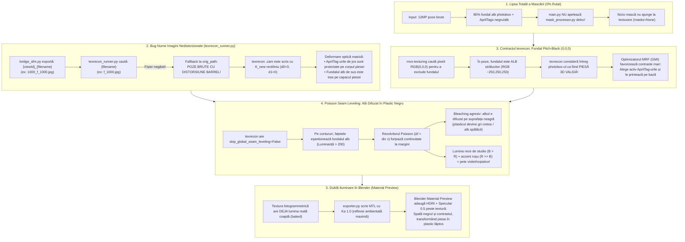

# PLAN ARHITECTURAL ȘI DE IMPLEMENTARE: REPARAREA COMPLETĂ A TEXTURĂRII 3D (TURNTABLE STUDIO)

**Data:** 26 Octombrie 2026  
**Status:** În așteptare aprobare utilizator (NO CODE IMPLEMENTATION YET)  
**Țintă:** Pipeline-ul curent funcțional de la commit `bun` (`a066913`)  
**Obiect de test:** Șurubelniță electrică Parkside (plastic negru/gri închis tehnic cu butoane/accente roșii, montată pe platan rotativ de 260mm cu markeri AprilTag).

---

## 1. Diagnostic: De ce textura generată este albă, pătată și include AprilTag-uri?

Pe baza analizei exhaustive efectuate de cei 3 subagenți de cercetare (Matematică de Proiecție, Segmentare/Mascare și Pipeline de Culoare/Shader), au fost identificate **5 cauze principale concrete** care se combină în cascada de procesare:



---

## 2. Puncte Cheie Verificate Pozitiv (Ce funcționează DEJA bine)

1. **Matematica camerelor în `.cam` este corectă:**
   - Vectorul de translație $T = -R \cdot C$, rotația World-to-Camera $R_{W \to C}$ în format Row-Major, normalizarea $f_{\text{norm}} = f_x / \max(W, H)$ și centrul optic $(c_x/W, c_y/H)$ sunt calculate 100% conform specificației originale MVE / `texrecon`.
2. **Sistemul de coordonate și Scara 1:1:**
   - Atât mesh-ul (`model_cleaned_watertight.obj`), cât și camerele din `cameras_known.sfm` sunt exprimate în **METRI**, cu originea în centrul platanului. Nu există dezaliniere geometrică între mesh și camere în timpul texturării.
3. **Ordinea canalelor de culoare:**
   - OpenCV citește/scrie BGR pe disc în mod simetric (pe disc fișierele rămân RGB standard). Pillow procesează RGB nativ. Nu există o inversare globală brută $R \leftrightarrow B$.

---

## 3. Planul de Acțiune în 4 Etape (Fără CREStereo)

### Etapa 1: Mascare Automată Hibridă și Eliminarea Totală a Turntable-ului (Platan + AprilTags)
*Cerință imperativă:* **Doar obiectul trebuie să fie vizibil.** Niciun pixel din platanul rotativ (suprafață albă, markeri AprilTag, margini de disc sau photobox) nu are voie să intre în textură.

#### Cum garantăm eliminarea 100% a turntable-ului:
1. **Tăiere Geometrică 3D în spațiul camerelor (`project_cylinder_to_2d`):**
   - Platanul rotativ se află matematic în planul $Y = 0.0\text{ m}$ (conform `platan_260mm_layout.json`).
   - Înălțimea minimă a volumului 3D al piesei este setată la $Y_{\text{min}} = 0.003\text{ m}$ ($3.0\text{ mm}$ deasupra suprafeței discului, identic cu planul de tăiere din `mesh_cleaner.py`).
   - Raza cilindrului este setată la $R_{\text{cyl}} = 0.080\text{ m}$ ($80\text{ mm}$ — scula are raza maximă sub $45\text{ mm}$, în timp ce platanul are $130\text{ mm}$).
   - **Rezultat:** Întreaga zonă a platanului aflată la $Y \le 0.003\text{ m}$ și orice element dincolo de raza piesei sunt decupate instantaneu și marcate ca fundal (`0`).
2. **Segmentare Fotometrică și Filtrare Componente Conexe:**
   - În interiorul ROI-ului geometric, pixelii de contrast ai sculei (plastic tehnic negru/gri și butoane roșii) sunt separați de eventuale reflexii.
   - Filtrarea prin componente conexe (BFS) păstrează **exclusiv corpul principal al piesei** și elimină orice fragment rezidual de la marginea de contact cu platanul.
   - O eroziune de siguranță de 1 pixel curăță conturul exterior, prevenind pixelii albi de margine („fringe”).
3. **Neutralizarea Imaginii (Black-Out 100% pentru tot ce nu e piesă):**
   - Masca binară este aplicată direct pe imaginile nedistorsionate:
     $$\text{Dacă } \text{mască}(u, v) == 0 \implies \text{Pixel}(u, v) = [0, 0, 0] \text{ (Pitch Black)}$$
   - În imaginile rezultate, **turntable-ul, AprilTag-urile și pereții photobox-ului devin un vid negru absolut `RGB(0, 0, 0)`**.
   - Doar șurubelnița electrică rămâne vizibilă în culorile ei reale.
4. **Comportamentul Motoarelor de Texturare cu Fundal Negru:**
   - **În `texrecon`:** Funcția `TextureView::generate_validity_mask()` marchează automat toți pixelii `RGB(0,0,0)` ca `INVALID`. Nicio rază nu va proiecta platanul pe model.
   - **În OpenMVS:** `--empty-color 0` garantează că baza plată tăiată la $Y=0.0$ este colorată într-un negru neutru curat, fără artefacte.
   - **În `DensifyPointCloud`:** Argumentul `--ignore-mask-label 0` împiedică OpenMVS să genereze puncte 3D pe platan, eliminând zgomotul de la bază încă din faza de geometrie.

---

### Etapa 2: Corectarea Căutării Imaginilor Nedistorsionate în `texrecon_runner.py`
*De ce este critic:* `texrecon` primea pozele brute distorsionate pentru că numele fișierului nu se potrivea.
1. În `pipeline/texrecon_runner.py`, extinderea listei de căutare a imaginilor:
   ```python
   # Verificare ordine: {viewId}_{fname}, fname, {viewId}_{stem}.png, {stem}.png, etc.
   cand_names = [
       f"{v['viewId']}_{orig_path.name}",
       orig_path.name,
       f"{v['viewId']}_{orig_path.stem}.png",
       f"{orig_path.stem}.png",
   ]
   ```
2. Acest lucru garantează că `texrecon` încarcă **strict imaginile nedistorsionate rectilinii**, sincronizate la perfecție cu matricile $K_{\text{new}}$ din fișierele `.cam`.

---

### Etapa 3: Dezactivarea / Reglarea Difuziei Poisson (Seam Leveling)
*De ce este critic:* Împiedică difuzia luminii albe sau a fundalului peste plasticul negru.
1. **Pentru `texrecon` (`pipeline/config.py`):**
   - Setare `skip_global_seam_leveling = True`. Fără nivelare globală Poisson, fiecare fațetă își păstrează culorile reale fotografiate (negru adânc, roșu viu), fără să fie spălată de media globală a cadrului.
   - Setare `skip_local_seam_leveling = False` (sau local restrâns la 1px), pentru a uniformiza doar muchiile dintre insulele UV.
2. **Pentru `OpenMVS TextureMesh`:**
   - Menținerea regulii `--global-seam-leveling 0` (deja configurată) și `--empty-color 0` (negru pentru fațetele neobservate de la bază).
   - Transmiterea argumentelor `--mask-path output/masks` și `--ignore-mask-label 0` către `TextureMesh`.

---

### Etapa 4: Corectarea Materialului `.mtl` și Previzualizarea Corectă în Blender
*De ce este critic:* Modelele fotogrammetrice au deja iluminarea inclusă în textură; un shader difuz standard în Blender le dublează lumina.
1. În `pipeline/exporter.py` la scrierea `.mtl`:
   ```text
   newmtl material_0
   Ka 0.000000 0.000000 0.000000    # Elimină iluminarea ambientală artificială care spală negrul
   Kd 1.000000 1.000000 1.000000    # Păstrează albedo-ul 1:1 din fișierul PNG
   Ks 0.000000 0.000000 0.000000    # Fără reflexii speculare false peste textura coaptă
   d 1.000000
   illum 1
   map_Kd model_high_texture.png
   ```
2. În modelul `.glb`, este deja activă extensia `KHR_materials_unlit` (care afișează culorile exacte fără interferența lămpilor din scenă).
3. Corectarea bug-ului de **dublă scalare** pe ramura fallback de low-poly din `exporter.py` (pentru a evita scalarea cu $10,000\times$).

---

## 4. Matrice de Comparație: Înainte vs. După Implementare

| Componentă | Comportament Actual (`a066913`) | Comportament După Implementare |
| :--- | :--- | :--- |
| **Mascarea Fundalului** | ❌ 0% executată. Fundalul alb și AprilTag-urile sunt vizibile în poze. | ✅ Mascare automată hibridă (ROI 3D + segmentare) cu fundal pitch-black `RGB(0,0,0)`. |
| **Imagini în `texrecon`** | ❌ Încarcă poze brute cu distorsiune radială barrel din cauza nepotrivirii de nume. | ✅ Încarcă strict imaginile rectilinii nedistorsionate `{viewId}_{name}.png`. |
| **AprilTag-uri pe Model** | ❌ Grav afectat. Tag-urile sunt proiectate pe corpul și baza piesei. | ✅ 100% eliminate. Platanul este tăiat geometric sub $Y \le 3\text{ mm}$ și mascat la negru. |
| **Culori / Tonuri** | ❌ Plastic negru spălat în alb cretos; accente roșii pătate cu violet. | ✅ Culori reale: plastic negru/gri tehnic profund, accente roșii clare, fără difuzie Poisson. |
| **Compatibilitate Motoare** | ⚠️ `texrecon` activat implicit dar cu bug-uri de path; OpenMVS fallback. | ✅ Ambele motoare (`texrecon` și `OpenMVS`) funcționează perfect cu măști. |

---

## 5. Pași Următori & Validare

1. **Aprobare Utilizator:** Utilizatorul confirmă planul propus.
2. **Implementare Pas cu Pas:**
   - Modificare `bridge_sfm.py` și `texrecon_runner.py` (fix potrivire imagini + fundal negru).
   - Activare mascare automată în `main.py` (ROI + segmentare).
   - Ajustare `TexReconConfig` (`skip_global_seam_leveling=True`).
   - Fix `exporter.py` (`Ka 0.0` și rezolvare dublă scalare).
3. **Rulare Teste Automate:**
   - Execuție suită `tests/` cu `python -m unittest discover -v -s tests`.
4. **Test Practic în Docker:**
   - Rulare pipeline pe setul de imagini din `input_images/` și verificarea texturii rezultate.
