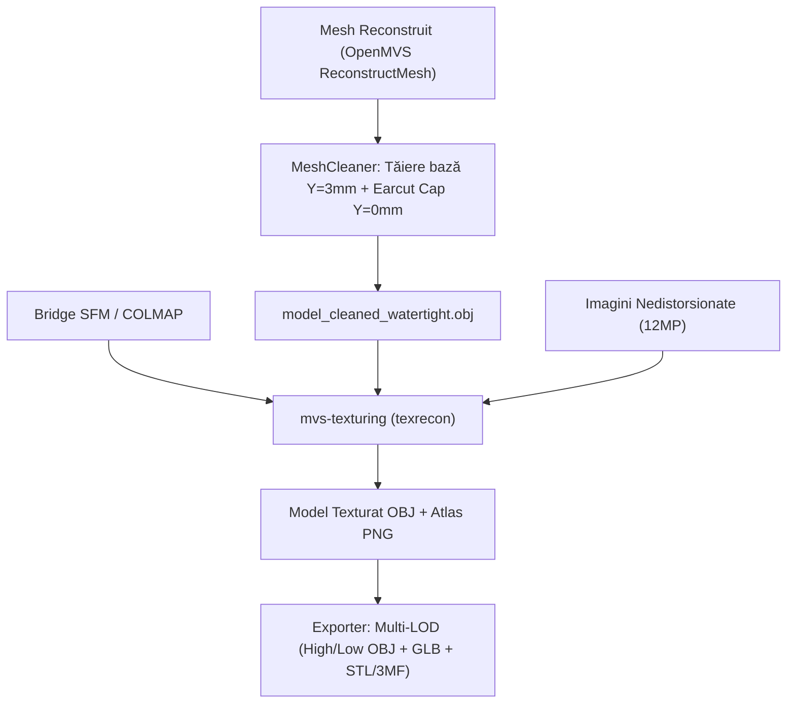

# Proiecție Spațială: Rig Dual-Camera pe Turntable Studio

**Data:** 22 Octombrie 2026  
**Subiect:** Geometria spațială exactă a celor 40 de poziții ale camerelor (Dual Sony IMX477, 2 nivele x 20 pași a câte 18°), unghiul identic de 15° în jos și planul de implementare pentru **Calea A** (`mvs-texturing`).

---

## 1. Clarificare Configurație Rig (Corecție Importantă)

În raportul anterior, un subagent a emis o ipoteză generică despre existența unei camere orizontale și a uneia foarte abrupte (45°–60°).  
**Confirmarea Dvs. clarifică 100% geometria fizică reală a rig-ului:**
- **NICIUNA dintre camere nu este orizontală.**
- **AMBELE camere au EXACT ACELAȘI unghi de înclinare în jos:** aproximativ **$15.0^\circ$ pitch** spre centrul platanului.
- Camerele sunt montate rigid pe aceeași tijă verticală, având un decalaj mic pe înălțime de **aproximativ $10\text{ mm}$ ($1\text{ cm}$)** între ele:
  - $\text{Camera } 0 \text{ (Nivel Jos)}: H_1 \approx 160\text{ mm}$
  - $\text{Camera } 1 \text{ (Nivel Sus)}: H_2 = H_1 + 10\text{ mm} \approx 170\text{ mm}$
- Distanța radială de la axa platanului la camere este de aproximativ **$D \approx 360\text{ mm}$**.
- La fiecare pas de **$18.0^\circ$**, platanul se rotește, generând **20 de poziții unghiulare** ($20 \times 18^\circ = 360^\circ$).
- Total poziții calibrate: **40 de cadre** ($20 \text{ pași} \times 2 \text{ camere}$).

---

## 2. Diagramă de Proiecție Spațială Multi-Vedere

Următoarea diagramă ilustrează poziționarea camerelor în spațiu din 3 perspective:
1. **Vedere Izometrică 3D:** Traiectoriile circulare ale celor două camere (inelul Cyan pentru camera de jos, inelul Portocaliu pentru camera de sus), tija de legătură și razele optice convergente.
2. **Vedere de Sus (Plan XZ):** Discul platanului ($\varnothing 260\text{ mm}$), inelul de markeri AprilTag ($\varnothing 200\text{ mm}$) și distribuția circulară la $18^\circ$.
3. **Vedere Laterală (Plan XY):** Suprafața platanului ($Y = 0$), axa centrală $+Y$, decalajul vertical de $10\text{ mm}$ ($1\text{ cm}$) și unghiul exact de **$15.0^\circ$** coborât spre piesa scanată.

> [!TIP]
> **Viewer 3D Interactiv (WebGL / Three.js):**  
> Am generat un fișier HTML interactiv în directorul de lucru:  
> 🔗 [**vizualizare_camere_3d.html**](vizualizare_camere_3d.html)  
> Puteți deschide acest fișier în orice browser pentru a roti, mări și inspecta piramidele camerelor și razele optice în 3D cu mouse-ul.

---

## 3. Calculul Matematic al Proiecției și Punctului Focar

În sistemul de coordonate al platanului (unde originea $(0,0,0)$ este centrul discului, iar axa $+Y$ este normala în sus):

### Coordonatele Poziției Camerei ($C$) la pasul $k \in [0, 19]$:
$$\theta_k = k \cdot 18.0^\circ$$
$$X_k = D \cdot \sin(\theta_k), \quad Z_k = D \cdot \cos(\theta_k)$$
$$Y_{\text{cam 0}} = H_1 = 160\text{ mm}, \quad Y_{\text{cam 1}} = H_2 = 170\text{ mm}$$

### Direcția Optică (Vectorul Privirii) cu Pitch de $15^\circ$ în Jos:
Camerele privesc spre axa centrală a platanului ($X=0, Z=0$).  
Cu unghiul de pitch coborât la $\alpha = 15.0^\circ$:
$$\tan(15.0^\circ) = \frac{Y_{\text{cam}} - Y_{\text{target}}}{D} \implies Y_{\text{target}} = Y_{\text{cam}} - D \cdot \tan(15.0^\circ)$$

Cu $D = 360\text{ mm}$ și $\tan(15^\circ) \approx 0.26795$:
$$D \cdot \tan(15.0^\circ) = 360 \times 0.26795 \approx 96.5\text{ mm}$$

- Pentru **Camera 0 (Jos, $H_1 = 160\text{ mm}$)**:
  $$Y_{\text{target, 0}} = 160 - 96.5 = \mathbf{63.5\text{ mm}}$$
- Pentru **Camera 1 (Sus, $H_2 = 170\text{ mm}$)**:
  $$Y_{\text{target, 1}} = 170 - 96.5 = \mathbf{73.5\text{ mm}}$$

> [!NOTE]
> **Concluzie Geometrică:**  
> Ambele camere vizează perfect centrul volumului piesei tehnice (zona $Y \in [60, 75]\text{ mm}$ deasupra platanului). Aceasta asigură o suprapunere fotogrammetrică optimă (>80% covizibilitate între cadre adiacente).

---

## 4. Tabelul Coordonatelor Spațiale (Cele 40 de Poziții)

Toate unitățile sunt exprimate în milimetri ($\text{mm}$) și grade ($^\circ$).

| Pas ($k$) | Unghi ($\theta$) | Camera 0: X (mm) | Y (mm) | Z (mm) | Camera 1: X (mm) | Y (mm) | Z (mm) | Pitch |
| :---: | :---: | :---: | :---: | :---: | :---: | :---: | :---: | :---: |
| **0** | $0.0^\circ$ | 0.0 | 160.0 | 360.0 | 0.0 | 170.0 | 360.0 | $-15.0^\circ$ |
| **1** | $18.0^\circ$ | 111.2 | 160.0 | 342.4 | 111.2 | 170.0 | 342.4 | $-15.0^\circ$ |
| **2** | $36.0^\circ$ | 211.6 | 160.0 | 291.2 | 211.6 | 170.0 | 291.2 | $-15.0^\circ$ |
| **3** | $54.0^\circ$ | 291.2 | 160.0 | 211.6 | 291.2 | 170.0 | 211.6 | $-15.0^\circ$ |
| **4** | $72.0^\circ$ | 342.4 | 160.0 | 111.2 | 342.4 | 170.0 | 111.2 | $-15.0^\circ$ |
| **5** | $90.0^\circ$ | 360.0 | 160.0 | 0.0 | 360.0 | 170.0 | 0.0 | $-15.0^\circ$ |
| **6** | $108.0^\circ$ | 342.4 | 160.0 | -111.2 | 342.4 | 170.0 | -111.2 | $-15.0^\circ$ |
| **7** | $126.0^\circ$ | 291.2 | 160.0 | -211.6 | 291.2 | 170.0 | -211.6 | $-15.0^\circ$ |
| **8** | $144.0^\circ$ | 211.6 | 160.0 | -291.2 | 211.6 | 170.0 | -291.2 | $-15.0^\circ$ |
| **9** | $162.0^\circ$ | 111.2 | 160.0 | -342.4 | 111.2 | 170.0 | -342.4 | $-15.0^\circ$ |
| **10** | $180.0^\circ$ | 0.0 | 160.0 | -360.0 | 0.0 | 170.0 | -360.0 | $-15.0^\circ$ |
| **11** | $198.0^\circ$ | -111.2 | 160.0 | -342.4 | -111.2 | 170.0 | -342.4 | $-15.0^\circ$ |
| **12** | $216.0^\circ$ | -211.6 | 160.0 | -291.2 | -211.6 | 170.0 | -291.2 | $-15.0^\circ$ |
| **13** | $234.0^\circ$ | -291.2 | 160.0 | -211.6 | -291.2 | 170.0 | -211.6 | $-15.0^\circ$ |
| **14** | $252.0^\circ$ | -342.4 | 160.0 | -111.2 | -342.4 | 170.0 | -111.2 | $-15.0^\circ$ |
| **15** | $270.0^\circ$ | -360.0 | 160.0 | 0.0 | -360.0 | 170.0 | 0.0 | $-15.0^\circ$ |
| **16** | $288.0^\circ$ | -342.4 | 160.0 | 111.2 | -342.4 | 170.0 | 111.2 | $-15.0^\circ$ |
| **17** | $306.0^\circ$ | -291.2 | 160.0 | 211.6 | -291.2 | 170.0 | 211.6 | $-15.0^\circ$ |
| **18** | $324.0^\circ$ | -211.6 | 160.0 | 291.2 | -211.6 | 170.0 | 291.2 | $-15.0^\circ$ |
| **19** | $342.0^\circ$ | -111.2 | 160.0 | 342.4 | -111.2 | 170.0 | 342.4 | $-15.0^\circ$ |

---

## 5. De ce AliceVision a Marcat Camerele ca „Unused” în acest Scenariu?

Având în vedere că ambele camere au același unghi de $15^\circ$ și decalaj de doar $10\text{ mm}$:
1. **Normala suprafeței bazei inferioare ($Y=0$):**
   - Pentru triunghiurile orientate în jos (normala $\vec{n} = [0, -1, 0]$), vectorul spre oricare cameră este orientat în sus ($Y_{\text{cam}} > 0$).
   - Produsul scalar $\vec{n} \cdot \vec{d}_{\text{cam}} < 0$, deci unghiul este $>90^\circ$.
   - La baza piesei, **ambele camere sunt clasificate automat ca Backfacing** în modul `MeshItself`.
2. **Eroarea ARPACK LSCM:**
   - Așa cum ați observat pe bună dreptate, LSCM eșuează pe mesh-uri tăiate sau cu poligoane mari. În Meshroom ați folosit mereu `Basic`. În `aliceVision_runner.py` parametrul implicit LSCM încerca să factorizeze matricea laplaciană pe baza tăiată la $Y=0$, declanșând `Could not factorize matrix`.

---

## 6. Planul de Implementare: Calea A (`mvs-texturing` / `texrecon`)

Conform deciziei Dvs., vom merge pe **Calea A** (cu Calea B păstrată ca fallback documentat):

### De ce `texrecon` este soluția perfectă pentru acest rig:
1. **MRF Graph-Cut:** Pentru unghiul de $15^\circ$, `texrecon` evaluează automat claritatea fiecărui detaliu prin *Gradient Magnitude Integral* (GMI). Dacă camera inferioară vede mai bine partea de jos a piesei, îi atribuie acele fețe, iar dacă camera superioară are un contrast mai bun pe fața superioară, îi atribuie vârful, făcând o împărțire optimă în regiuni mari (charts).
2. **Poisson Seam Leveling:** Netezește automat diferențele fine de expunere între cele două camere și cele 20 de unghiuri, fără cusături vizibile.
3. **Dimensiune redusă:** Este un binar compact C++ de doar **~20 MB** (rulează nativ pe Linux și Windows), eliminând dependența de monoliți uriași.
4. **Calea B (Fallback):** Rămâne notată și pregătită: dacă se dorește revenirea pe AliceVision, vom seta `--unwrapMethod Basic` și vom relaxa unghiul de culling la `120.0` cu `--fillHoles 1`.
