# Turntable Studio — Industrial 3D Scanning Pipeline

High-precision, industrial-grade 3D photogrammetry pipeline engineered specifically for **automated turntable scanning rigs**. It transforms multi-view photographs of mechanical parts, technical plastics, and power tools into production-ready, textured, watertight 2-manifold 3D CAD assets (OBJ, GLB, STL, 3MF) in both High-Poly and Low-Poly LODs.

* **Locked Camera Poses (Zero BA Drift):** Camera poses are determined deterministically from **AprilTags** on the turntable platter (`pipeline/turntable_poses.py`) and rigidly locked. Classic Structure-from-Motion (SfM) bundle adjustment is prevented from drifting on dark, glossy, or textureless technical plastics.
* **GPU Mesh Reconstruction:** Powered by **OpenMVS** (CUDA PatchMatch multi-view depth maps → Delaunay tetrahedralization & graph-cut surface extraction, regularized with fine-tuned smoothing).
* **High-Fidelity Texturing:** Powered by **mvs-texturing (`texrecon`)** using Markov Random Field (MRF) Potts optimization to assemble large, continuous chart atlases without Poisson bleeding or confetti micro-patches. OpenMVS `TextureMesh` serves as an automated fallback.
* **Watertight CAD Base:** Automates planar base slicing at $Y = 3.0\text{ mm}$ and seals boundary contours using robust 2D polygon Ear-Clipping with volume-preserving Taubin smoothing.
* **Flexible Execution:** Runs locally (bare-metal or containerized via Docker with NVIDIA GPU passthrough) or fully serverless in the cloud (one on-demand RunPod GPU pod per scan, streaming assets through Cloudflare R2).

---

## 1. Physical Rig & Hardware Configuration

The Turntable Studio pipeline is mathematically calibrated to a dual-camera automated turntable rig:

```
                      [ Z-Axis Lead Screw (T8) ]
                                  │
                   ▲              │  Carriage Lift (~80 mm/level)
                   │              ▼
       ┌──────────────────────────────────────┐
       │   Rigid Horizontal Carriage Bar      │
       └───┬──────────────────────────────┬───┘
           │                              │
     [ Camera 0 ]                   [ Camera 1 ]
   Sony IMX477 12MP               Sony IMX477 12MP
   (M12 3.9mm lens)               (M12 3.9mm lens)
      Height: ~135 mm                Height: ~135 mm (Same level, ±1.8 mm)
      Pitch:  ~14°-15° down          Pitch:  ~14°-15° down
           \                              /
            \       ◄── 27° ──►          /
             \  (Horizontal Azimuth)    /
              \                        /
               ▼                      ▼
       ════════════════════════════════════════
             [ 345 mm Turntable Platter ]
             12 AprilTags (Tag36h11) Outer Ring
             Rotates in 18° Steps (20 steps/turn)
```

### Rig Specifications:
* **Cameras:** Dual **Sony IMX477 12.3MP** rolling-shutter CMOS sensors ($4056 \times 3040\text{ px}$, $1.865\,\mu\text{m}$ pixel pitch).
* **Lenses:** Dual **3.9mm M12** wide-angle lenses ($\approx 75^\circ$ horizontal FOV, low barrel distortion $k_1 \approx -0.04$).
* **Camera Placement (Same Level):** Both cameras are rigidly mounted to the **same horizontal carriage bar at the same height** ($Y \approx 135\text{ mm}$ above the platter surface, with a mechanical tolerance under $2\text{ mm}$).
* **Camera Pitch:** Both cameras are tilted downward toward the platter center at the **same nominal pitch angle of $\approx 14^\circ - 15^\circ$**.
* **Horizontal Separation ($27^\circ$ Azimuthal Offset):**
  * The cameras are separated horizontally around the turntable rotation axis by **$27^\circ$**, establishing a physical stereo baseline of $b \approx 160\text{ mm}$.
  * **Interleaved Vernier Sampling:** The $27^\circ$ camera separation and the $18^\circ$ turntable rotation step form an exact **$1.5\times$ Vernier ratio** ($27^\circ = 18^\circ + 9^\circ$). At each step, Camera 1 samples a viewpoint shifted by $9^\circ$ relative to Camera 0's previous stop. This yields **40 distinct horizontal perspectives at $9^\circ$ intervals** across the full $360^\circ$ circle from only 20 physical motor stops.
* **Turntable Platter:** Stepper-motor-driven rotating disc with 20 stops per revolution ($18^\circ$ angular step). Default is the **$345\text{ mm}$ platter** (`platan_345mm_layout.json`) with an outer ring of 12 AprilTags (Tag36h11 family, printed at $0.99$ scale, $307\text{ mm}$ opposite tag distance). Legacy $260\text{ mm}$ platters (`platan_260mm_layout.json`) are also supported.
* **Z-Axis Linear Motion:** A T8 trapezoidal lead screw with stepper motor lifts the entire dual-camera carriage between vertical scanning levels (nominal lift of $80\text{ mm}$ per level, automatically measured and estimated in photos with $\ge 2$ levels).

---

## 2. Pipeline Architecture & Workflow

```mermaid
flowchart TD
    A["Photos<br/>input_images/rig/0 and rig/1"] --> B["1. CameraInit<br/>Extract views & intrinsics"]
    B --> C["2. turntable_poses<br/>AprilTags -> Locked Camera Poses"]
    C --> RR["2.1 Rig Refinement<br/>Per camera + level sparse SIFT correction"]
    RR --> D["2.5 Hybrid Mask Fusion<br/>BiRefNet_lite + Background Median + Rendered Disc"]
    D --> V["2.6 Visual Hull<br/>1.5 mm voxel grid volume carving"]
    V --> E["3. SFM-to-COLMAP Bridge<br/>Image undistortion & 1,500 proxy 3D tracking points"]
    E --> R{"RAM Check<br/>Density memory validation"}
    R --> F["4. OpenMVS DensifyPointCloud<br/>CUDA PatchMatch depth maps & cloud fusion"]
    F --> HC["4.2b Hull Cloud Pruning<br/>Prune phantom depths & fill textureless surface"]
    HC --> RM["4.3 OpenMVS ReconstructMesh<br/>Delaunay tetrahedralization & graph-cut surface"]
    RM --> G["5. Mesh Cleaning<br/>3 mm base slicing, ear-clipping cap & Taubin smoothing"]
    G --> H["5.5 Texturing Image Preparation<br/>Mesh-silhouette masks & camera white balancing"]
    H --> T["6. mvs-texturing (texrecon)<br/>MRF Potts chart texturing (Fallback: TextureMesh)"]
    T --> X["7. Multi-LOD Export<br/>High/Low OBJ, GLB (Draco), watertight STL, 3MF"]
    X --> Z["Deliverables: output.zip + stats.json + object.json"]
```



### Pipeline Stages:
1. **Camera Discovery & Init (`pipeline/camera_init.py`):** Discovers stereo images (`rig/0` and `rig/1`), parses level and step indices (`f_<level><step>.jpg`), and initializes metadata.
2. **AprilTag Poses (`pipeline/turntable_poses.py`):** Detects AprilTag corners, fits a 23-parameter global kinematic turntable model (rotation axis, angular step, lift scale, optical centers, focal length, radial distortion), and locks camera poses to sub-pixel accuracy ($\text{RMSE} < 0.45\text{ px}$). Supports **Zero-Tag Prediction** when large parts occlude the disc.
3. **Rig Refinement (`pipeline/rig_refine.py`):** Corrects mechanical carriage tilt ($\approx 0.9^\circ$) on upper levels using hold-out guarded sparse SIFT matches on the object.
4. **Hybrid Mask Fusion (`pipeline/mask_fusion.py`):** Combines lightweight deep learning (BiRefNet_lite 512 ONNX CPU) on a dynamic object crop with per-level background median subtraction and synthetic 3D disc projection.
5. **Visual Hull (`pipeline/visual_hull.py`):** Carves a $1.5\text{ mm}$ voxel volume from multi-view silhouettes to bound proxy points and prune floating depth artifacts.
6. **SFM-to-COLMAP Bridge (`pipeline/bridge_sfm.py`):** Undistorts 4K frames and injects 1,500 synchronized proxy 3D points inside the visual hull bounding volume.
7. **OpenMVS Core (`pipeline/openmvs_runner.py`):** Computes per-view depth maps with CUDA PatchMatch, fuses them into a dense point cloud, and reconstructs a manifold triangular surface mesh.
8. **Mesh Cleaning & Base Sealing (`pipeline/mesh_cleaner.py`):** Isolates the scanned object by spatial position, executes planar slicing at $Y = 3.0\text{ mm}$, caps all base boundary loops with 2D ear clipping, and applies Taubin volume-preserving smoothing.
9. **Texturing (`pipeline/texrecon_runner.py`):** Projects high-resolution photos into UV chart atlases via `texrecon` using global MRF Potts energy minimization.
10. **Multi-LOD Packaging (`pipeline/exporter.py`):** Decimates topology, embeds Draco-compressed geometry for GLB, writes watertight STL/3MF for 3D printing, and measures physical dimensions for `object.json`.

---

## 3. Directory Layout

```text
input_images/
└── rig/
    ├── 0/                 # Camera 0 (Left)
    │   ├── f_1000.jpg     # Level 1, Step 0
    │   ├── f_1001.jpg     # Level 1, Step 1 (18° rotation)
    │   ├── ...
    │   ├── f_2000.jpg     # Level 2, Step 0 (Carriage lifted +80 mm)
    │   └── ...
    └── 1/                 # Camera 1 (Right), synchronized filenames
```

* Naming convention: `f_<level><step:03d>.jpg` (e.g. `f_1000.jpg` = Level 1, Step 0; `f_2019.jpg` = Level 2, Step 19).
* Without `rig/` (single camera flat folder), omit `--rig_mode`.

---

## 4. How to Run

### A. Docker (Recommended for GPU & Production)

#### 1. Build the Docker Image
Always pass `GIT_COMMIT` so the container embeds the exact version tag into `stats.json`:

```bash
# Standard Docker build with Git commit argument
docker build \
  --build-arg GIT_COMMIT=$(git rev-parse --short HEAD) \
  -t turntable-studio:latest .
```

#### 2. Run via Docker Compose (Simplest)
`docker-compose.yml` mounts host directories and configures NVIDIA GPU passthrough automatically:

```bash
# Build with commit hash
GIT_COMMIT=$(git rev-parse --short HEAD) docker compose build

# Run pipeline on input_images/ with output in output/
docker compose run --rm turntable-studio \
  --input_dir /workspace/input_images \
  --output_dir /workspace/output \
  --rig_mode
```

#### 3. Run Directly via `docker run`
For custom host paths, CI runners, or explicit volume control:

```bash
docker run --rm -it \
  --gpus all \
  --shm-size=16g \
  -v "$(pwd)/input_images:/workspace/input_images:ro" \
  -v "$(pwd)/output:/workspace/output" \
  turntable-studio:latest \
  --input_dir /workspace/input_images \
  --output_dir /workspace/output \
  --rig_mode
```

#### 4. Re-Texturing / Re-Exporting (`--resume`)
To change texturing or export settings without recomputing expensive CUDA depth maps and Delaunay meshing:

```bash
docker compose run --rm turntable-studio \
  --input_dir /workspace/input_images \
  --output_dir /workspace/output \
  --rig_mode \
  --resume
```

---

### B. Local Bare-Metal (Native Execution)

Requires Python 3.10 or 3.11, OpenMVS binaries (compiled with CUDA), and `texrecon`:

```bash
# 1. Create and activate virtual environment
uv venv .venv --python 3.11 && source .venv/bin/activate    # Windows: .venv\Scripts\activate
uv pip install -r requirements.txt

# 2. Run full pipeline
python main.py \
  --input_dir ./input_images \
  --output_dir ./output \
  --rig_mode \
  --openmvs_bin_dir /path/to/OpenMVS/bin \
  --texrecon_bin /path/to/texrecon
```

#### Fast Mock Test (No GPU / No OpenMVS Required)
Validates argument parsing, AprilTag detection, mask generation, mesh cleaning, and export packaging without requiring OpenMVS binaries:

```bash
python main.py --mock_openmvs --rig_mode --input_dir ./input_images --output_dir ./output_test
```

---

### C. Cloud Serverless (RunPod + Cloudflare R2)

One scan = one on-demand GPU pod, launched dynamically when needed and terminated the instant results are secured in R2.

```text
Local Machine / Raspberry Pi ──── Upload Photos ────▶ Cloudflare R2 (jobs/<id>/input/)
                                                             │
                                                     Launch On-Demand Pod
                                                             ▼
                                                    RunPod NVIDIA GPU Pod
                                                    (OpenMVS + texrecon)
                                                             │
                                                     Upload Results
                                                             ▼
Local Machine ◄─── Download & Verify output.zip ─── Cloudflare R2 (jobs/<id>/output/)
```

1. **Setup Environment:**
   Copy `.env.example` to `.env` and fill in your Cloudflare R2 credentials, `RUNPOD_API_KEY`, and `TURNTABLE_IMAGE` (Docker image in a public or private registry).

2. **Execute Cloud Scan:**
   ```bash
   # Dry-run check (validates credentials, estimates RAM and cost; no pod created)
   python tools/cloud_scan.py --dry_run

   # Full cloud scan execution (uploads photos, runs pod, downloads results to results/<id>/)
   python tools/cloud_scan.py --input_dir ./input_images

   # Re-run a previous scan with photos already in R2
   python tools/cloud_scan.py --job_id <id> --skip_upload
   ```

---

## 5. Output Deliverables Contract

Every successful run outputs the following structured assets in `output/` (and packaged in `output.zip`):

```text
output/
├── glb/
│   ├── high_model.glb         # High-Poly GLB with embedded PNG textures (Draco compressed)
│   └── low_model.glb          # Web-optimized Low-Poly GLB with embedded JPG textures
├── obj/
│   ├── high/
│   │   ├── model_high.obj     # Full detail polygonal mesh
│   │   ├── model_high.mtl     # Material definition
│   │   └── model_high_texture.png
│   └── low/
│       ├── model_low.obj      # Web LOD polygonal mesh (topology-preserved)
│       ├── model_low.mtl
│       └── model_low_texture.jpg (Max 2048px)
├── stl/
│   ├── high_model.stl         # Watertight, 2-manifold CAD mesh (Z-up, scale in mm)
│   └── low_model.stl          # Watertight Low-Poly for 3D slicing
├── 3mf/
│   ├── high_model.3mf         # Modern manufacturing format with unit & orientation metadata
│   └── low_model.3mf
├── object.json                # Physical metadata: dimensions (LxWxH mm), volume (cm³), surface area
├── stats.json                 # Comprehensive execution telemetry: RAM, VRAM, step timings, warnings
├── run_log.txt                # Complete execution log (UTF-8)
└── output.zip                 # Self-contained distribution archive for R2 / client download
```

### Coordinate Systems & Metric Units:
* **Internal Processing:** Metres, Y-up, turntable platter plane at $Y = 0.0\text{ m}$.
* **OBJ, STL, 3MF:** Millimetres (`--export_scale 1000`). STL & 3MF are oriented Z-up with the base resting on $Z = 0.0\text{ mm}$ for direct 3D slicer compatibility (Bambu Studio, PrusaSlicer, Cura).
* **GLB:** Scaled at $100\text{ units/m}$ (centimetres) for web viewers, or $1\text{ unit/m}$ for standard glTF conformance via `--glb_scale 1`.
* **`object.json`:** Real-world measurements calculated directly from the unscaled metric mesh.

---

## 6. Testing

The repository contains an automated unit test suite covering geometry, calibration math, masks, mesh slicing, and cloud protocols:

```bash
# Run full unit test suite with uv
uv run --with numpy --with opencv-python-headless --with scipy --with trimesh \
       --with shapely --with mapbox-earcut --with psutil --with pillow \
       --with networkx --with pymeshlab --with boto3 --with requests \
       --with lxml --with DracoPy \
       python -m unittest discover -v -s tests
```
