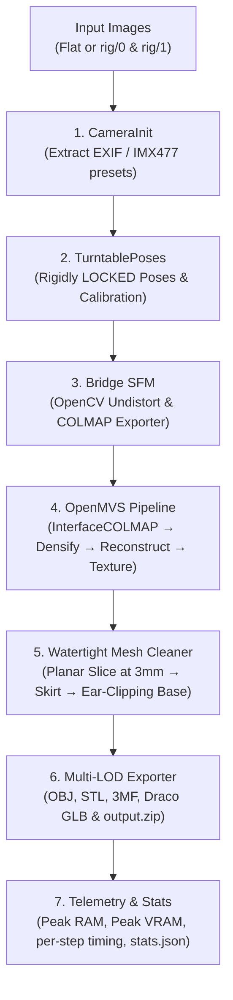

# Turntable Studio — Industrial 3D Photogrammetry Pipeline

Turntable Studio is a high-precision, studio-grade 3D photogrammetry pipeline designed for turntable scanning rigs (e.g. dual Arducam Sony IMX477 cameras). It replaces the heavy and noisy parts of Meshroom (DepthMap, Meshing, Texturing) with **OpenMVS**, enforces rigidly locked camera poses via **TurntablePoses**, seals the base into a watertight CAD-ready 3D print pedestal, and exports multi-LOD assets with full telemetry.

---

## 1. System Architecture



---

## 2. Python Environment & Versioning

> [!IMPORTANT]
> **Use Python 3.10 or 3.11.**
> Do **NOT** use Python 3.14 (or early alpha releases). Scientific packages like `pymeshlab`, `scipy`, `trimesh`, and `opencv-python` do not have pre-built wheels for Python 3.14 on Linux/Windows and will fail during installation.

### Quick Setup with `uv` (Recommended):
```bash
# Create Python 3.11 virtual environment
uv venv .venv --python 3.11
source .venv/bin/activate

# Install dependencies
uv pip install -r requirements.txt
```

### Standard `venv` Setup:
```bash
python3.11 -m venv .venv
source .venv/bin/activate  # On Windows: .venv\Scripts\activate
pip install -r requirements.txt
```

---

## 3. Input Directory Layouts

### A. Rig Mode (`--rig_mode`)
Designed for dual-camera rigs where both cameras shoot simultaneously at each turntable step:
```text
input_images/
├── rig/
│   ├── 0/               # Camera 1 (Lower angle)
│   │   ├── 0000.jpg
│   │   ├── 0001.jpg
│   │   └── ...
│   └── 1/               # Camera 2 (Upper angle)
│       ├── 0000.jpg
│       ├── 0001.jpg
│       └── ...
└── masks/               # Optional SAM / BiRefNet masks
    ├── 0000.mask.png
    └── ...
```

### B. Flat Mode
Single camera turntable scan:
```text
input_images/
├── 0000.jpg
├── 0001.jpg
├── ...
└── 0019.jpg
```

---

## 4. Running with Docker (Linux Server / RunPod / Cloud)

Docker is the recommended deployment method for cloud servers (RunPod, AWS, GCP) with NVIDIA GPUs.

### Build and Run with Docker Compose:
```bash
# Build the CUDA 12 + OpenMVS container
docker compose build

# Run the pipeline
docker compose up
```

### Run Directly via Docker CLI:
```bash
docker run --gpus all --rm \
  -v $(pwd)/input_images:/workspace/input_images:ro \
  -v $(pwd)/output:/workspace/output:rw \
  turntable-studio:latest \
  --input_dir /workspace/input_images \
  --output_dir /workspace/output \
  --rig_mode \
  --resolution_level 1
```

---

## 5. Running Locally on Windows x64 (Native)

You can run Turntable Studio directly on Windows without Docker:

1. **Download OpenMVS for Windows:**
   - Download the latest pre-compiled Windows x64 release from [OpenMVS Releases](https://github.com/cdcseacave/openMVS/releases) (e.g. `openMVS_v2.3.0_win64.zip`).
   - Extract it to `C:\OpenMVS`.
   - Add `C:\OpenMVS` to your system `PATH` or set the environment variable:
     ```powershell
     $env:OPENMVS_BIN_DIR = "C:\OpenMVS"
     ```

2. **Run the Python Pipeline:**
   ```powershell
   python main.py --input_dir .\input_images --output_dir .\output --rig_mode
   ```

---

## 6. CLI Arguments & Configuration

| Parameter | Type | Default | Description |
| :--- | :--- | :--- | :--- |
| `--input_dir`, `-i` | `str` | `./input_images` | Path to images directory |
| `--output_dir`, `-o` | `str` | `./output` | Path for deliverables |
| `--rig_mode` | `flag` | `False` | Enables dual-camera rig layout (`rig/0`, `rig/1`) |
| `--openmvs_bin_dir`, `--bin_dir` | `str` | `None` | Path to OpenMVS directory (e.g. `C:\OpenMVS` or `C:\OpenMVS\bin`) |
| `--resolution_level` | `int` | `1` | OpenMVS downscale (`0` = 4K full, `1` = 2K, `2` = 1K) |
| `--step_deg` | `float` | `18.0` | Turntable rotation step in degrees (20 steps/turn) |
| `--mock_openmvs` | `flag` | `False` | Simulates OpenMVS for testing without binaries |

---

## 7. Deliverables & Output Structure

Once complete, the `output/` directory contains:
```text
output/
├── output.zip                  # Full package ready for Cloudflare R2 / S3
├── stats.json                  # JSON telemetry report (RAM, VRAM, timing)
├── turntable_report.txt        # TurntablePoses angular accuracy report
├── model_cleaned_watertight.obj# Cleaned watertight model
├── obj/
│   ├── high/model_high.obj     # High-poly OBJ + PNG textures
│   └── low/model_low.obj       # Low-poly OBJ (50k faces) + JPG textures
├── stl/
│   ├── high_model.stl          # Watertight 3D printing STL
│   └── low_model.stl           # Decimated STL
├── 3mf/
│   ├── high_model.3mf          # Slicer-ready 3MF
│   └── low_model.3mf
└── glb/
    ├── high_model.glb          # Full-res web / AR 3D asset
    └── low_model.glb           # Draco-compressed low-poly GLB
```

---

## 8. Telemetry & Performance Monitoring

The pipeline automatically benchmarks each stage and outputs a telemetry summary:

```text
==============================================================================
                   TURNTABLE STUDIO — EXECUTION TELEMETRY
==============================================================================
 Total Time : 1m 42.5s (102.5s)
 Peak RAM   : 4.82 GB (4935.6 MB) / 31.2 GB Total
 Peak VRAM  : 6.14 GB (6287.0 MB)
------------------------------------------------------------------------------
 STEP NAME                        | TIME (s)   | PEAK RAM (MB)  | VRAM (MB)
------------------------------------------------------------------------------
 1. Camera Discovery & Init       |      0.45s |          124.0 |        -
 2. Turntable Poses (Rigid Lock)  |      8.20s |         1420.5 |        -
 3. Bridge SFM & Undistortion     |      5.12s |         1845.2 |        -
 4.1 OpenMVS InterfaceCOLMAP      |      1.10s |          450.0 |        -
 4.2 OpenMVS DensifyPointCloud    |     48.30s |         4935.6 |     6140
 4.3 OpenMVS ReconstructMesh      |     14.80s |         3210.0 |     4200
 4.4 OpenMVS TextureMesh          |     12.40s |         2100.4 |     3800
 5. Watertight Base Slicing       |      3.20s |         1120.0 |        -
 6. Multi-LOD Export              |      8.93s |         1850.0 |        -
------------------------------------------------------------------------------
```
