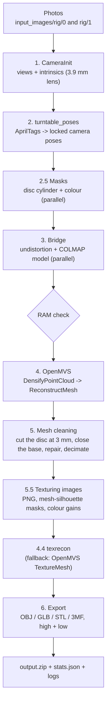

# Turntable Studio — 3D scanning pipeline for a turntable rig

Turns the photos of a turntable scanner (two Sony IMX477 cameras on a vertical carriage, a 260 mm disc with
12 AprilTags) into textured, watertight 3D models: OBJ, GLB, STL and 3MF in a high- and a low-poly version.

* Camera poses come from the **AprilTags on the disc** (`turntable_poses.py`), not from feature matching, and are
  locked: on dark, glossy or plain plastics classic structure-from-motion drifts.
* Geometry: **OpenMVS** (CUDA PatchMatch depth maps → Delaunay / graph-cut mesh).
* Texture: **mvs-texturing (`texrecon`)**, with OpenMVS `TextureMesh` as fallback.
* Runs locally (Docker or native) or **in the cloud**: one RunPod pod per scan, photos and results through
  Cloudflare R2.

---

## 1. How it works



| Step | What happens | Module |
|---|---|---|
| 1. CameraInit | Finds the photos, reads the level / step from the file name (`f_2005.jpg` = level 2, step 5), writes `cameraInit.sfm` | `pipeline/camera_init.py` |
| 2. Poses | Detects the 12 AprilTags in every photo and fits one rigid turntable model (step angle, rotation axis, lift per level, camera intrinsics). Writes `cameras_known.sfm`, `turntable_report.txt` (RMS, lift, per-photo errors) and `turntable_calib.json` | `pipeline/turntable_poses.py` (**never modified**, called as a subprocess) |
| 2.5 Masks | Object vs background: inside an 80 mm × 350 mm cylinder around the axis, not white, not a tag | `pipeline/mask_processor.py` |
| 3. Bridge | Undistorts photos and masks, writes the COLMAP model OpenMVS imports (poses + 1500 synthetic tracking points) | `pipeline/bridge_sfm.py` |
| RAM check | Estimates DensifyPointCloud's RAM from photos × resolution and stops in seconds if the container cannot hold it | `pipeline/resources.py` |
| 4. OpenMVS | Depth map per photo on the GPU, fusion into a dense point cloud, surface mesh. Depth maps are deleted after fusion | `pipeline/openmvs_runner.py` |
| 5. Cleaning | Keeps the largest part, cuts at Y = 3 mm (removes the disc), closes the base flat, repairs, decimates to 250 k faces + a 50 k low-poly copy | `pipeline/mesh_cleaner.py`, `pipeline/exporter.py` |
| 5.5 Texturing images | Lossless PNGs where everything outside the mesh silhouette is exactly black, per-camera colour gains from the white paper | `pipeline/texture_prep.py`, `pipeline/mesh_masks.py` |
| 4.4 Texturing | `texrecon` picks the best photo per face and builds the atlases; unseen faces are coloured like their neighbours | `pipeline/texrecon_runner.py` |
| 6. Export | OBJ + MTL + PNG/JPG, GLB with embedded textures, watertight STL / 3MF at real scale, `output.zip` | `pipeline/exporter.py` |

Everything the run measured (time, RAM, VRAM, CPU, disk per step, hardware, object, mesh quality) goes into
`stats.json`; the full log into `run_log.txt` (section 7).

### Coordinates and units
The model is built in **metres**, Y up, the disc surface at Y = 0. Exports use `--export_scale 100`
(the OBJ/GLB/STL/3MF units then read as the real size in the slicer / viewer; tested — do not change).
The AliceVision `.sfm` conventions (column-major rotations, principal point as offset from the centre) are in `AGENTS.md`.

---

## 2. Input

```text
input_images/
└── rig/
    ├── 0/                 # camera 0
    │   ├── f_1000.jpg     # level 1, step 0
    │   ├── f_1001.jpg     # level 1, step 1 (18° later)
    │   ├── ...
    │   ├── f_2000.jpg     # level 2 (carriage moved up)
    │   └── ...
    └── 1/                 # camera 1, same names
```

* File names end in `<level><3-digit step>` (`f_1005` → level 1, step 5). 20 steps of 18° per level.
* Without `rig/` (flat folder, one camera) run without `--rig_mode`.
* Optional: own masks in `input_images/masks/` (`<viewId>_<stem>.mask.png`); otherwise they are generated.

### Good scans
* The disc must stay **in frame** on every level (at least ~4 tags per photo; the report shows `tag-uri pe poză: min`).
* The real carriage lift was measured at ~85 mm, not the nominal 80/100 mm: use **`--estimate_lift`**.
* Plain, glossy surfaces (a cap of one colour) give no depth (nothing to match between photos): side lighting or
  matte scanning spray help. Open issues and their fixes: `plans/AUDIT_RECONSTRUCTIE_GENERALA.md`.

---

## 3. Running

### A. Docker on the GPU machine (Windows + Docker Desktop, or Linux)

```bash
# once, and after code changes (GIT_COMMIT is recorded in stats.json)
GIT_COMMIT=$(git rev-parse --short HEAD) docker compose build

# a scan: photos in ./input_images, results in ./output
docker compose run --rm turntable-studio --input_dir /workspace/input_images --output_dir /workspace/output --rig_mode --estimate_lift
```

PowerShell: `docker compose build`, then the same `docker compose run ...` line. No `| tee` is needed:
the log is written to `output/run_log.txt` by the pipeline itself (UTF-8).

What `docker-compose.yml` mounts:

| Host | Container | Contents |
|---|---|---|
| `./input_images` | `/workspace/input_images` (read-only) | photos |
| `./output` | `/workspace/output` | models, `output.zip`, `stats.json`, logs, reports, masks, texrecon files |
| volume `turntable_work` | `/tmp/turntable_work` | undistorted images, COLMAP files, OpenMVS scene and depth maps |

The work volume matters on Windows: a folder of `D:\` mounted through WSL is several times slower for the ~9 GB of
depth maps (DensifyPointCloud spent ~14 of its 18.5 minutes on disk there). It persists between runs, so `--resume`
still works. To keep everything in `./output` (e.g. for `tools/debug_texturing.py`) add `--work_dir /workspace/output`.

Re-texture / re-export without recomputing the geometry:
```bash
docker compose run --rm turntable-studio --input_dir /workspace/input_images --output_dir /workspace/output --rig_mode --estimate_lift --resume
```
`--resume` reuses `cameras_known.sfm` and the OpenMVS mesh. Run **without** it after changing photos, poses or
intrinsics.

WSL memory: DensifyPointCloud needs ~10–12 GB for 80–120 photos. If Docker Desktop has less, raise `memory=` in
`%UserProfile%\.wslconfig` and run `wsl --shutdown`.

### B. Native (without Docker)

Needs OpenMVS (with CUDA) and `texrecon` on the machine; Python 3.10 or 3.11 (not 3.14: no wheels for pymeshlab / scipy).
```bash
uv venv .venv --python 3.11 && source .venv/bin/activate     # Windows: .venv\Scripts\activate
uv pip install -r requirements.txt
python main.py --input_dir ./input_images --output_dir ./output --rig_mode --estimate_lift \
    --openmvs_bin_dir /path/to/OpenMVS --texrecon_bin /path/to/texrecon
```
OpenMVS is also searched in `OPENMVS_BIN_DIR`, `PATH`, `/usr/local/bin/OpenMVS`, `C:\OpenMVS\...`; texrecon in
`TEXRECON_BIN`. Without texrecon the pipeline falls back to OpenMVS `TextureMesh`.

Quick check without OpenMVS (fake geometry, all later steps run):
```bash
python main.py --mock_openmvs --rig_mode --input_dir ./input_images --output_dir ./output_test
```

### C. Cloud: RunPod + Cloudflare R2

One scan = one pod, created for the job and terminated as soon as the result is in R2.
```
laptop / Pi ──upload photos──▶ R2 jobs/<id>/input/ ──▶ pod: download, run, upload ──▶ R2 jobs/<id>/output/
            ◀──────────────── download results/<id>/, delete jobs/<id>/ ◀────────────────────────────
```
* The pod gets **temporary R2 keys** (1 hour, read-only on its photos, write-only on its output), never your keys,
  never the RunPod key.
* GPU: the first available from a list ordered by price, with a minimum host RAM computed from the photos and a
  minimum vCPU count. GPU speed barely matters; RAM, CPUs and disk do.
* Every pod is terminated, also after errors, timeouts and cancels; one retry with more RAM if it ran out of memory.

Once:
1. Push the image to a registry: `docker tag turntable-studio:latest ghcr.io/<user>/turntable-studio:v1 && docker push ...`
   (private registry: add its credentials in RunPod → Settings → Container Registry Auth).
2. `cp .env.example .env` and fill in: R2 bucket key, Cloudflare API token with R2 permissions only,
   `CLOUDFLARE_ACCOUNT_ID`, `RUNPOD_API_KEY`, `TURNTABLE_IMAGE`.

Then, from the repository root:
```bash
python tools/cloud_scan.py --dry_run     # R2 check + RAM/disk estimate + the pod request, no pod, no cost
python tools/cloud_scan.py               # upload input_images/ -> pod -> results/<job_id>/ -> clean R2
python tools/cloud_scan.py D:\scans\multimeter --name multimeter --set tag_scale=1.002   # any folder, any pipeline option
python tools/cloud_scan.py --keep_remote # leave the job in R2 (debugging)
python tools/cloud_scan.py --job_id <id> --skip_upload   # retry with the photos already in R2
```
It asks before starting the (billed) pod (`-y` skips the question); Ctrl+C terminates the pod. It prints the time of every phase, the GPU / RAM / vCPU received and the cost estimate. Details, key permissions,
`status.json` and the Pi upload queue: [`cloud/README.md`](cloud/README.md).

---

## 4. Output

```text
output/
├── glb/high_model.glb, low_model.glb          # open in Windows 3D Viewer, Blender, any glTF viewer
├── obj/high/model_high.obj + .mtl + model_high_tex_*.png
├── obj/low/model_low.obj   + .mtl + model_low_tex_*.jpg   (≤ 2048 px)
├── stl/high_model.stl, low_model.stl          # watertight, flat base: straight into the slicer
├── 3mf/high_model.3mf, low_model.3mf
├── output.zip       # all of the above + stats.json + reports + logs/ (run_log, OpenMVS, texrecon)
├── stats.json       # measurements of the run (section 7)
├── run_log.txt      # full log, UTF-8
├── turntable_report.txt, turntable_calib.json # pose quality: RMS, tags per photo, lift, per-photo errors
├── cameraInit.sfm, cameras_known.sfm          # views, locked poses
├── masks/, texturing_images/, texrecon/       # intermediate files (useful for debugging)
└── model_cleaned_watertight.obj, cleaned_mesh_low.obj
```
Blender: switch the viewport to *Material Preview*. If two runs reuse the same texture file names, Blender may show
the old texture from its cache: reload the images or restart Blender.

### Reading `turntable_report.txt`
* `Total: ... RMS x px`: tag reprojection error. ~3 px today; < 1 px needs a chessboard calibration (`--intrinsics_in`).
* `Urcare: x mm/nivel, unghi față de axă y°`: lift per level. A large angle (> 2°) or a large free-pose difference on one
  level means the lift is wrong: use `--estimate_lift`.
* `tag-uri pe poză: min n`: below ~4 the top level loses the disc.

---

## 5. Options

Run `python main.py --help` for all of them. The ones that matter:

| Option | Default | Meaning |
|---|---|---|
| `--rig_mode` | off | photos in `rig/0`, `rig/1` |
| `--estimate_lift` | off | estimate the carriage lift (recommended; the real lift is ~85 mm) |
| `--lift_mm` | 100 | fixed lift per level when not estimated |
| `--tag_scale` | 1.0 | printed / designed size of the tag sheet (measure tag 0–6 centres: designed 200 mm) |
| `--intrinsics_in` | – | chessboard calibration from `pipeline/calibrate_intrinsics.py` |
| `--no_tag_refine` | off | disable the per-tag paper-height correction |
| `--resolution_level` | 1 | DensifyPointCloud at 1/2 resolution (0 = full: ~4× GPU time and much more RAM) |
| `--resume` | off | reuse poses and the OpenMVS mesh |
| `--texturing_engine` | texrecon | or `openmvs` (TextureMesh) |
| `--data_term` | gmi | texrecon: `gmi` or `area` |
| `--target_low_poly_faces` | 50000 | low-poly size |
| `--workers` | 0 = auto | parallel images for masks / undistortion / texturing images: `min(CPUs − 1, free RAM / 0.5 GB)` from the container limits |
| `--work_dir` | output dir (Docker: `/tmp/turntable_work`) | where the large intermediate files go |
| `--keep_depth_maps` | off | keep OpenMVS `depth*.dmap` (~74 MB each) |
| `--ram_margin` | 1.0 | safety factor on the RAM estimate before DensifyPointCloud |
| `--mock_openmvs` | off | fake geometry for quick tests |

Texture tuning (texrecon seam leveling, unseen faces, mask margin, colour gains) and the OpenMVS `TextureMesh`
options are listed by `--help`.

---

## 6. Resources

* **RAM.** DensifyPointCloud dominates: ≈ 6.8 GB + 12 bytes × photos × working pixels (80 photos → 9.8 GB, 120 → 11.3 GB
  at level 1; full resolution ~25–40 GB). The check uses the container's limit (cgroup), not the host RAM.
  `tools/fit_ram_model.py <stats.json...>` refits the formula from more runs.
* **Parallelism** only raises RAM inside the parallel steps (~0.5 GB per worker), which stay below DensifyPointCloud.
  Masks: 66 s → 15 s with 8 workers on 120 photos.
* **GPU.** NVIDIA with CUDA is required (OpenMVS is built with CUDA); its speed matters little (~4 of 30 minutes).
  OpenMVS uses ~0.6 GB of VRAM (one depth map at a time); more VRAM does not speed one job up.
* **Disk.** ~9 GB of depth maps at their peak for 120 photos at level 1 (4× at level 0); a fast disk matters most.
* **Docker image.** Runtime on `nvidia/cuda:12.2.2-base` with only the OpenMVS apps used, `texrecon` and the libraries
  `ldd` reports (`docker/runtime_deps.sh`); the build fails with "Missing shared libraries" if one is missing.

---

## 7. stats.json and the log

`stats.json` (`schema_version` 2) is meant as training data for predicting RAM, time, disk, cost and quality:

* **run:** id, start time, outcome (`ok` / `error` + error type + failed step), code version (git commit / image);
* **hardware:** CPU model and cores, GPU model / VRAM / compute capability / driver, host (local, WSL, RunPod),
  measured disk write/read speed of the work and output directories, container CPUs and RAM, workers;
* **input:** photos per level and camera, resolution, JPEG size, settings; pose quality (RMS, tags per photo, lift,
  free-pose difference per level); the object in the images (fraction of the frame, texture inside the mask,
  brightness, saturation, white/specular share, bounding box);
* **per step:** duration, peak RAM, peak VRAM minus what was already in use, CPU seconds and utilisation
  (low = waiting on disk or GPU), disk read/write, peak disk usage;
* **results:** OpenMVS GPU seconds, discarded depths, dense points, Delaunay cells; raw and cleaned mesh (faces,
  components, boundary edges, watertight); texrecon unseen faces; warnings / errors; zip size;
* **cloud jobs:** the pod rented (GPU, RAM, vCPU), price, cost, image pull + boot time, transfer times.

`python tools/collect_stats.py results/*/stats.json output/stats.json -o runs.csv` turns many runs into one table.

`run_log.txt` contains everything printed plus the OpenMVS output; `output.zip/logs/` also holds the OpenMVS and
texrecon logs.

---

## 8. Repository

```text
main.py                  pipeline (CLI and run_pipeline(job))
runpod_job.py            inside a RunPod pod: R2 -> run_pipeline -> R2
docker_entrypoint.sh     container entry: runpod_job.py if JOB_ID is set, else main.py
Dockerfile, docker-compose.yml, docker/runtime_deps.sh
requirements-runtime.txt (image) / requirements.txt (+ local tools)
.env.example             keys for the cloud flow (.env is ignored by git and Docker)
pipeline/                the steps of section 1, resources.py (RAM/CPU), run_metrics.py (stats), telemetry.py
cloud/                   cloudflare_r2.py, runpod.py, job.py, README.md
tools/                   local only: cloud_scan.py, collect_stats.py, fit_ram_model.py,
                         debug_texturing.py (texture diagnostics), debug_blender_compare.py (headless Blender)
tests/                   unit tests (no GPU, no network)
plans/                   open plans (AUDIT_RECONSTRUCTIE_GENERALA.md = next fixes); plans/implemented/ = done
docs/                    architecture description, competition documentation
deprecated/              code no longer used (AliceVision texturing, inspect_rig_poses.py)
to_delete/               superseded files, kept until reviewed
```

Tests:
```bash
uv run --with numpy --with opencv-python-headless --with scipy --with trimesh --with shapely --with mapbox-earcut \
  --with psutil --with pillow --with networkx --with pymeshlab --with boto3 --with requests --with lxml \
  python -m unittest discover -s tests
```

---

## 9. Troubleshooting

* **Pieces or holes on one level, `turntable_report.txt` RMS ≫ 3 px or a large free-pose difference on the upper
  levels** → wrong lift: `--estimate_lift`.
* **"Not enough RAM: DensifyPointCloud needs about X GB"** → more memory for Docker/WSL, a pod with more RAM, or
  `--resolution_level 1` / fewer photos.
* **DensifyPointCloud killed without a message (exit 137)** → out of memory (WSL limit); same fixes.
* **Black model in Blender** → *Material Preview*; after `--resume` with changed poses run without `--resume`.
* **Holes in the middle of the object, flattened plain caps** → masks and plain surfaces: see
  `plans/AUDIT_RECONSTRUCTIE_GENERALA.md` (G1–G3) and the debugging images it lists.
* **Red `NativeCommandError` in PowerShell** → only docker writing a warning to stderr; not an error of the run.
* **Texture debugging** → `python tools/debug_texturing.py all --output_dir output --input_dir input_images`
  (needs `undistorted/` in `output/`: run with `--work_dir /workspace/output`).
